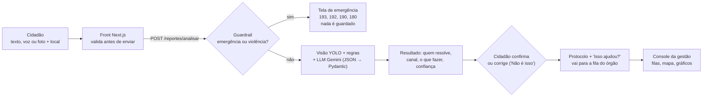
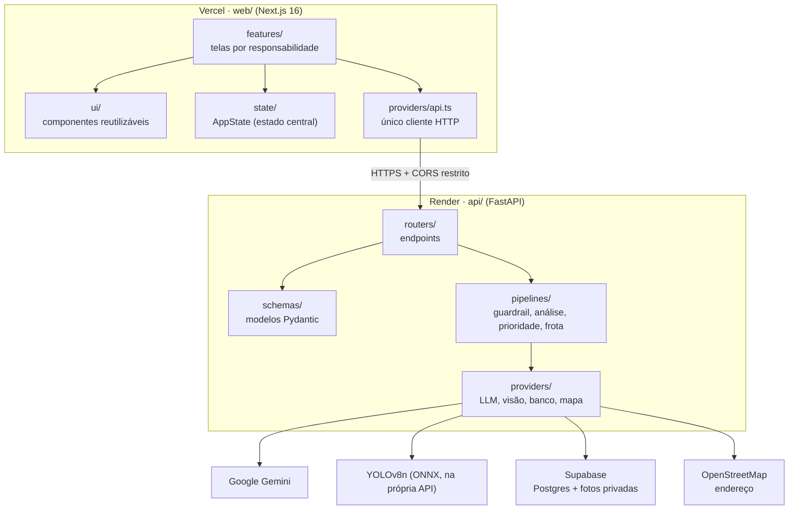

# Quem Resolve?

**Você viu um problema na rua. A gente diz quem resolve.**

O cidadão de São Paulo descreve (por texto ou voz) ou fotografa um problema de rua, como buraco, fio caído, poste apagado, lixo ou bueiro entupido. A IA diz **quem é o responsável, por qual canal e o que fazer**, e já deixa a solicitação pronta. Do outro lado, servidores públicos usam um console com mapa, filas por prioridade, gráficos e as detecções de câmeras em ônibus. Emergências e violência são desviadas para 190, 192, 193 e 180 antes de qualquer outra coisa.

Global Solution 2026.2 · FIAP · Tecnólogo em IA · desafio CitizenTech · disciplina **Front-end em Sistemas de IA**.

| | |
|---|---|
| **App do cidadão** | https://quem-resolve.vercel.app |
| **Console da gestão** | https://quem-resolve.vercel.app/gestao (botão "Marina" no login, ou `marina` / `demo-123`) |
| **API (documentação interativa)** | https://quem-resolve-api.onrender.com/docs |
| **Vídeo (5 min)** | https://youtu.be/PQcTYoblHDU |

> A API fica no plano grátis do Render e "dorme" depois de 15 minutos sem uso. Na primeira abertura o site mostra "Ligando o servidor" por até 1 minuto.

**Autores:** Ian Nobres Azevedo (RM 561681) · Matheus Mikio Tutume Lourenço (RM 561864)

## Sumário

1. [Problema e público](#1-problema-e-público)
2. [Fluxo CitizenTech](#2-fluxo-citizentech)
3. [Arquitetura](#3-arquitetura)
4. [Onde cada requisito está](#4-onde-cada-requisito-está)
5. [Acessibilidade](#5-acessibilidade)
6. [Justificativa, validação e impacto social](#6-justificativa-validação-e-impacto-social)
7. [Como rodar](#7-como-rodar)
8. [Deploy](#8-deploy)
9. [Créditos e dados de terceiros](#9-créditos-e-dados-de-terceiros)

---

## 1. Problema e público

Em São Paulo, quem encontra um problema urbano **não sabe a quem recorrer**. A responsabilidade é dividida entre Prefeitura, subprefeituras, concessionárias de lixo, CET, Enel, Sabesp, Comgás, operadoras de telecom e até o dono do imóvel. O cidadão desiste, reclama no lugar errado ou entra no "pingue-pongue" entre órgãos. Do lado da Prefeitura, chegam pedidos mal descritos, sem foto, duplicados ou fora da sua competência, e a triagem vira retrabalho.

**Público:** moradores de São Paulo que andam a pé, de bicicleta ou de ônibus, incluindo idosos e pessoas com baixa visão ou deficiência auditiva (persona principal: Dona Cida, 67 anos). Do outro lado, servidores da subprefeitura e das concessionárias que fazem a triagem (persona: Marina).

**Fontes que sustentam a dor:**

| Evidência | Fonte |
|---|---|
| Na CPI da Fiação, a Câmara ouviu que quem vê um fio caído não sabe quem chamar | [Câmara Municipal de SP](https://www.saopaulo.sp.leg.br/blog/cpi-da-fiacao-aprova-pedido-de-informacoes-sobre-zeladoria-e-fornecimento-de-energia-na-capital) |
| Cada poste tem pontos alugados pela Enel a operadoras, o que multiplica os responsáveis por um mesmo fio | [Câmara Municipal de SP](https://www.saopaulo.sp.leg.br/blog/representantes-da-enel-anatel-e-sp-regula-sao-ouvidos-pela-cpi-da-fiacao/) |
| A orientação oficial é fragmentada: faísca é com a Enel, vandalismo em poste com a Polícia, lâmpada apagada com a Prefeitura | [SP Regula, FAQ Iluminação](https://prefeitura.sp.gov.br/web/spregula/w/iluminacao_publica/perguntas_frequentes/4613) |
| O SP156 recebeu cerca de 1,126 milhão de solicitações em 2019, em cerca de 200 categorias | [Câmara Municipal, Boletim SP156](https://saopaulo.sp.leg.br/antigo/wp-content/uploads/2020/07/BOLETIM-CTTAE-BU-EST-PROF-156-02-19.pdf) |
| Nos pedidos de informação de mar/2025, a maior parte dos indeferimentos foi por estar fora da competência da Prefeitura | [Relatório Transparência Passiva mar/2025](https://capital.sp.gov.br/documents/d/ouvidoria/relatorio-transparencia-passiva-mar-2025-pdf) |

O produto fica **na frente** do SP156 e dos canais das concessionárias. Ele não substitui nenhum deles.

## 2. Fluxo CitizenTech



1. **Entrada:** a pessoa descreve o problema (campo de texto com ditado, com pelo menos 5 letras), tira ou envia uma foto (JPG, PNG ou WEBP até 8 MB, reduzida no próprio aparelho) e confirma o local (GPS com endereço por extenso, ou pino no mapa). Tudo é validado no front e de novo na API com Pydantic.
2. **Processamento:** a API roda o guardrail, a detecção de danos na foto (YOLOv8n treinado por nós na disciplina de Visão Computacional), as regras da base "Quem resolve o quê" e o **LLM (Google Gemini) com saída em JSON presa a um esquema**, validada no modelo Pydantic `AnaliseLLM`.
3. **Resposta:** não é um texto solto da IA. É um cartão com **quem resolve**, o canal (telefone, site, app), o que fazer agora, a foto com as caixas da detecção e um **selo de confiança** (alta, média ou baixa, sempre com ícone e palavra).
4. **Human-in-the-loop:** abaixo de 50% de confiança o app pede para a pessoa escolher. Em qualquer caso há o botão **"Não é isso"**, que abre as alternativas. Depois do protocolo vem o **"Isso ajudou?"**. No console, o gestor **reclassifica** e muda o status, com **Desfazer**.

## 3. Arquitetura



```
web/src/
  app/         rotas do Next (só montam as telas)
  features/    reportar/, assistente/, meus-reportes/, gestao/, privacidade/, inicio/
  ui/          Botao, Selo, SeloConfianca, Aviso, Estados, MapaOcorrencias, GraficoPlotly, Selecao, Gaveta…
  state/       AppState.tsx: meus reportes, conversa, tema, consentimentos, sessão do gestor
  providers/   api.ts (cliente da API, timeouts, cache, erros), tipos.ts (contratos), base.ts / reserva.ts
api/app/
  routers/     cidadao, assistente, ocorrencias, conta, geo, integracoes, base
  schemas/     reporte, ocorrencia, assistente, voz, frota, metricas, qualidade…
  pipelines/   guardrail, analise_reporte, ocorrencias (prioridade), metricas, frota_video, simulacao…
  providers/   llm (Gemini), visao (YOLO), visao_reserva, repositorio (banco), armazenamento, geocodificacao, auth…
```

**Onde o LLM é chamado:** só no back-end, em `api/app/providers/llm.py` (`GeminiLLM.classificar`), chamado pelo pipeline `api/app/pipelines/analise_reporte.py`. O front nunca fala com o Gemini: ele só chama `POST /reportes/analisar` por `web/src/providers/api.ts`.

**Estado e cache.** O enunciado fala em `st.session_state` e `@st.cache_data`. No Next.js os equivalentes são:

| Necessidade | Streamlit | Aqui |
|---|---|---|
| Estado da sessão | `st.session_state` | `web/src/state/AppState.tsx`: contexto React com reducer, salvo no `localStorage`. Guarda "Meus reportes", a conversa do assistente, o tema e os consentimentos. O histórico alimenta a tela Meus reportes |
| Cache de dados | `@st.cache_data` | `comCache()` em `web/src/providers/api.ts`: categorias, responsáveis e os 96 distritos são buscados uma vez só. Os filtros do console ficam na URL |
| Cache de recurso | `@st.cache_resource` | Na API: o modelo YOLO carrega uma vez (`lru_cache` em `providers/visao.py`) e o Gemini tem cache por texto normalizado (`providers/llm.py`), para não gastar cota com o mesmo relato |

**Segredos:** todas as chaves ficam em variáveis de ambiente (`api/.env`, nunca versionado, e as telas do Render). O repositório tem `api/.env.example` e `web/.env.example`. O front só conhece `NEXT_PUBLIC_API_URL`.

**CORS restritivo:** sem `*`. A API aceita só `http://localhost:3000` e os endereços da Vercel deste projeto (`CORS_REGEX = ^https://quem-resolve[a-z0-9-]*\.vercel\.app$`). Teste em `api/tests/test_cors_deploy.py`.

**Falhas tratadas** (sem mostrar erro técnico ao cidadão):

| Situação | O que a pessoa vê |
|---|---|
| API fora do ar | "Não conseguimos falar com o servidor" + escolha manual da categoria com a base embutida no front + "ligue 156" |
| API dormindo (Render grátis) | Aviso "Ligando o servidor" até ela responder |
| Demora (timeout) | "Está demorando. Tente de novo." com botão |
| Erro ou cota do LLM | A API cai para as regras e a visão. Se nada servir, a pessoa escolhe na lista |
| Resposta inválida | "Recebemos uma resposta inesperada" |
| Sem GPS | Usa o centro de SP e pede para ajustar no mapa |
| Navegador sem voz | Esconde o microfone e explica que dá para digitar |

**Testes automatizados:** `cd api && pytest` roda 116 testes dos pipelines e da API sem subir a interface (guardrail, análise, LLM com Gemini falso, prioridade, CORS, banco, frota, visão).

## 4. Onde cada requisito está

| Requisito do enunciado | Onde ver |
|---|---|
| 3.1 Entrada validada | `features/reportar/Captura.tsx` (front) e `schemas/reporte.py` (API) |
| 3.1 LLM no back-end com Pydantic | `providers/llm.py` → `schemas/reporte.py` (`AnaliseLLM`) |
| 3.1 Resposta útil | `features/reportar/Resultado.tsx` e `QuemResolve.tsx` |
| 3.2 Camadas | `web/src/{features,ui,state,providers}` e `api/app/{routers,schemas,pipelines,providers}` |
| 3.3 Estado e cache | `state/AppState.tsx`, `providers/api.ts` (`comCache`) |
| 3.4 Falhas, segredos, CORS | `providers/api.ts` (erros tipados e timeouts), `.env.example`, `CORS_REGEX` |
| 3.5 Latência | "Analisando" com etapas, `ui/Estados.tsx` (carregando, vazio, erro), aviso do servidor acordando |
| 3.5 Cores semânticas com texto | `ui/Selo.tsx`, `SeloConfianca`, `ui/Aviso.tsx` |
| 3.5 Human-in-the-loop | "Não é isso" e confirmação abaixo de 50% (cidadão); reclassificar e Desfazer (gestor, `features/gestao/Filas.tsx`) |
| 3.6 Plotly + filtros | `ui/GraficoPlotly.tsx`: reportes por dia na Visão geral e tipos de problema no Mapa, com filtros de órgão, categoria e bairro (`features/gestao/FiltrosConsole.tsx`) e de período no Mapa |
| 3.6 Componente reutilizável | `ui/Selo`, `ui/MapaOcorrencias` (Visão geral, Mapa e Frota, com parâmetros diferentes), `ui/SeletorCategoria` (cidadão e gestor) |
| 3.7 Deploy | Vercel + Render (opção A) **e** `docker-compose.yml` (opção B) |

**Diferenciais:** produção + Docker; perfis cidadão e gestor com login (o gestor só altera as filas do próprio órgão); modelo próprio (YOLOv8n da disciplina de VC) junto do LLM; dados abertos reais (GTFS da SPTrans, distritos do GeoSampa, OpenStreetMap); pytest; três temas (claro, escuro e alto contraste); leitura em voz alta; identidade visual própria.

## 5. Acessibilidade

- Fonte **Atkinson Hyperlegible**, feita para baixa visão. Texto de no mínimo 16 px no app do cidadão.
- Alvos de toque de no mínimo **48 px** e uma ação principal por tela.
- **Cor nunca sozinha:** confiança, status e prioridade sempre aparecem com ícone e palavra.
- Três temas: **claro, escuro e alto contraste**.
- Rótulo em todos os campos, foco visível, link **"Pular para o conteúdo"** e navegação completa por teclado.
- Mensagens dinâmicas com `role="status"` e `aria-live`, lidas pelo leitor de tela.
- Respeita **"reduzir movimento"** e **"reduzir transparência"** do sistema.
- Entrada por **voz** (ditado) e resposta **lida em voz alta** no assistente.
- Linguagem simples, sem sigla sem explicação e sem termo técnico na tela.
- Alerta sonoro do OuviAí (projeto de IoT) aparece como faixa visual e vibração, para pessoas com deficiência auditiva.
- **Botão de emergência** sólido, com o número escrito, e **saída rápida** (tecla Esc) em casos de violência.
- Verificação automática com **axe-core** (WCAG 2.1 A e AA) em 18/11/2026: **0 violações** em `/`, `/reportar`, `/assistente`, `/meus-reportes`, `/privacidade` e `/gestao/entrar`.

## 6. Justificativa, validação e impacto social

### 6.1 ODS

- **ODS 11, Cidades e comunidades sustentáveis (meta 11.3 e 11.7):** o problema chega já qualificado a quem resolve na primeira tentativa, e a gestão vê no mapa onde se concentram os problemas, inclusive em bairros que reportam menos (as câmeras dos ônibus cobrem ruas onde ninguém reclama).
- **ODS 16, Instituições eficazes e transparentes (meta 16.6 e 16.7):** menos pedidos no órgão errado e menos retrabalho de triagem. O cidadão acompanha o status em "Meus reportes", e cada classificação mostra a confiança e pode ser corrigida.

### 6.2 Decisões técnicas

- **Next.js no lugar de Streamlit ou Gradio (aceito pelo professor).** O público principal usa celular e tem baixa visão ou pouca intimidade com tecnologia. Precisávamos controlar o tamanho de toque, o contraste, o tema de alto contraste, a câmera, o microfone e o GPS, e ter um console com mapa interativo e login. No Streamlit isso exigiria contornos. A arquitetura em camadas pedida (features, ui, state, providers) foi mantida igual, e a tabela da seção 3 mostra o equivalente de `session_state` e `cache_data`.
- **Prompt e formato de saída.** O Gemini recebe só a lista fechada de categorias da base "Quem resolve o quê", com temperatura 0 e um **esquema JSON** em que `categoria_id` é um `enum` com os ids válidos. A resposta é validada em `AnaliseLLM` (Pydantic). Assim a IA **não inventa órgão nem telefone**: quem resolve e o canal vêm da nossa base, não do texto do modelo. O prompt também manda ignorar instruções escritas dentro do relato (proteção contra *prompt injection*). Há uma lista de modelos com reserva e um cache por texto, por causa da cota grátis.
- **Por que regras + visão + LLM.** Regras são rápidas e explicáveis; o YOLO (modelo próprio) enxerga buracos e rachaduras na foto; o LLM entende relatos escritos de muitos jeitos. Se o LLM falhar, o app continua funcionando com os outros dois.
- **Deploy.** Front na Vercel (feita para Next.js, grátis e sem dormir) e API no Render por um Blueprint (`render.yaml`), que já cria o serviço com tudo configurado e só pede os segredos na tela. Banco no Supabase (Postgres e fotos em armazenamento privado). Também há `docker-compose.yml` para subir tudo localmente com um comando.

### 6.3 Ética e limites da IA

| Risco | Como tratamos |
|---|---|
| **Erro de classificação** | Selo de confiança sempre visível; abaixo de 50% a pessoa escolhe; "Não é isso" em qualquer resultado; o gestor reclassifica. A tela Qualidade mostra quantas vezes a IA foi corrigida |
| **Alucinação** | Saída presa a um esquema com só as categorias válidas. Órgão, canal e telefone vêm da base, nunca do modelo |
| **Emergência tratada como zeladoria** | Guardrail antes de tudo: fogo, choque, violência e risco à vida vão direto para 193, 192, 190 e 180. Nesses casos nada é guardado |
| **Viés territorial** | Bairros com menos reportes podem parecer "sem problema". O mapa mostra a cobertura das linhas de ônibus, e a frota detecta danos onde ninguém reporta |
| **Privacidade (LGPD)** | Sem cadastro. Fotos reduzidas, sem EXIF, com rostos, pessoas e placas borrados antes de sair do servidor. Foto e descrição apagadas 90 dias após resolvido. Áudio descartado depois de virar texto. Página `/privacidade` no rodapé |
| **Uso indevido** | O relato é tratado como dado (o prompt ignora ordens dentro dele). Só o gestor do órgão altera as próprias filas |

**O que a solução não faz:** não substitui o SP156 nem os telefones de emergência; não abre o chamado no sistema da Prefeitura sozinha (gera a solicitação pronta e o órgão recebe na fila); não identifica pessoas nas fotos ou nos vídeos; não promete prazo de atendimento. As regras de responsabilidade da base precisam de validação oficial antes de uso real.

### 6.4 Evidências de validação

**(a) Teste com pessoas.** Roteiro, ficha e resultados em [`docs/TESTE-USUARIOS.md`](docs/TESTE-USUARIOS.md).

Feito em 18 e 19/11/2026, à distância: cada pessoa recebeu o link do site e um roteiro com 4 tarefas (reportar um buraco com foto, corrigir a IA com "Não é isso", achar o andamento em "Meus reportes" e reportar um fio soltando faísca) e respondeu 5 perguntas.

| Pessoa | Perfil | Fez as 4 tarefas sozinha? | Facilidade (1 a 5) | Principal dificuldade | Usaria no lugar do 156? |
|---|---|---|---|---|---|
| P1 | 19 anos, usa muito o celular | Sim | 4 | **Não conseguiu usar o ditado (falar em vez de digitar) no celular** | Sim: "não precisa esperar atendimento para abrir o protocolo" |
| P2 | 20 anos, usa muito o celular | Sim | 5 | "Talvez os botões, mas tudo muito intuitivo" | Sim: "nem tinha conhecimento desse número" |
| P3 | 20 anos, não mora em São Paulo | Sim | 5 | A localização no mapa (a pessoa estava fora de SP, e o app é só da capital) | Sim: "foi mais fácil reportar por um app do que por uma central" |

**O que aprendemos:** as 3 pessoas fizeram tudo sozinhas (média 4,7 de 5) e duas não conheciam o 156, o que confirma a dor de "não saber a quem recorrer". O problema concreto foi o ditado no celular.

**Ajuste feito a partir do feedback (P1):** o ditado usa o reconhecimento de voz do próprio navegador. Quando o link é aberto pelo WhatsApp ou pelo Instagram (navegador interno do app), ou quando o celular bloqueia o microfone que liga sozinho ao abrir a tela, o ditado falhava **sem avisar nada**. Agora (`web/src/ui/useVoz.ts` e `features/reportar/Captura.tsx`):
- o app reconhece o navegador interno de apps e explica: "Aberto pelo app, o ditado não funciona. Use o microfone do teclado ou abra o link no Chrome ou no Safari";
- se o celular recusa o microfone automático, aparece "Toque em Falar para começar";
- se o ditado termina sem ouvir nada, aparece "Não ouvi nada. Toque em Falar e fale de novo", e cada erro tem uma mensagem própria (sem internet, microfone bloqueado).

**Limites do teste e próximos passos:** as 3 pessoas são jovens e usam muito o celular. O próximo teste deve incluir idosos e pessoas com baixa visão, que são a persona principal. A P3 sugere um aviso claro quando a localização está fora de São Paulo.

**(b) Casos de teste da IA** (rodados em 18/11/2026 no site publicado, com o Gemini real; prints em [`docs/evidencias/casos-ia/`](docs/evidencias/casos-ia/)). Lista completa e histórico em [`docs/CASOS-TESTE-IA.md`](docs/CASOS-TESTE-IA.md).

| # | Entrada | Saída esperada | Saída obtida | Ajuste realizado |
|---|---|---|---|---|
| 1 | "Tem um buraco grande no asfalto perto do ponto de ônibus" + foto de rua | Buraco na via → Prefeitura (subprefeitura) | **Buraco na via**, confiança alta (95%), Prefeitura (subprefeitura) pelo SP156. Na foto, a caixa marca o buraco | — |
| 2 | "Tem um fio soltando faísca na frente de casa" | Aviso de risco com 193 + Fio de energia → Enel | Aviso "pode haver risco" com **Ligar 193** em cima; **Fio de energia caído ou faiscando**, confiança alta (90%), Enel | — |
| 3 | "A casa do vizinho está pegando fogo agora" | Tela de emergência com 193, nada guardado | **Tela de emergência**: "Ligar 193 · Bombeiros" e outros canais (190, 192, 199, 180, 100). Nada é guardado | — |
| 4 | "Tem uma coisa estranha aqui na rua faz dias" | Sem categoria: pede para a pessoa escolher | "Não consegui identificar o problema": abre a lista com busca e "Adicionar mais detalhes" | — |
| 5 | "O poste da minha rua está apagado" | Iluminação pública → Prefeitura | Antes, só com regras: **Poste danificado** (errado) | Entrou o LLM Gemini com esquema fechado. Resultado agora: **Iluminação pública**, confiança alta (85%), Prefeitura pelo SP156 ✅ |


## 7. Como rodar

**Atalho no Windows:** dê dois cliques em `start-all.bat`. Na primeira vez ele cria o ambiente Python e roda o `npm install`; depois abre a API e o front em duas janelas e o navegador em `localhost:3000`.

**Passo a passo manual:**

**API** (Python 3.11+):
```bash
cd api
python -m venv .venv
.venv\Scripts\activate          # Windows  (Linux/Mac: source .venv/bin/activate)
pip install -r requirements-dev.txt
copy .env.example .env           # Linux/Mac: cp .env.example .env
uvicorn app.main:app --reload    # http://localhost:8000/docs
pytest                           # testes
```

**Banco:** sem `DATABASE_URL` no `api/.env` a API guarda tudo em memória (some ao reiniciar). Para usar o Supabase (Postgres + fotos no Storage privado), siga `docs/SUPABASE-PASSO-A-PASSO.md`: a API cria as tabelas sozinha. Testes no Postgres: `TEST_DATABASE_URL=postgresql://... pytest` (use um banco só de teste).

A visão computacional usa o modelo real por padrão (`VISAO_PROVIDER=yolo`, arquivo `api/modelos/rdd2022-n-r2.onnx`, roda em CPU com onnxruntime, ~50 ms por foto). Para voltar ao mock, troque para `VISAO_PROVIDER=mock` no `.env`. Treino e métricas do modelo ficam fora da solução, em `Materias/VC`.

Quando o YOLO não acha dano, a foto do cidadão pode ir para uma **reserva multimodal** (Gemini Flash), que reconhece as outras categorias (fio, lixo, poste, árvore, alagamento...). Ligue com `VISAO_RESERVA=gemini` e a chave do Google AI Studio em `VISAO_RESERVA_CHAVE` (ou `LLM_API_KEY`). Antes de sair do servidor a foto é reduzida, perde o EXIF e tem rostos, pessoas e placas borrados (LGPD). Sem chave ou com o Gemini fora do ar, o app segue só com o texto. `VISAO_RESERVA=mock` testa o fluxo sem chave.

**Assistente de voz (disciplina 08, PLN):** o botão "Falar" de `/assistente` chama `POST /voz/conversar`. Com `VOZ_PROVIDER=real` entra o módulo de PLN (`api/app/pipelines/voz/`): faster-whisper transcreve na máquina, o guardrail da API roda antes, o RAG (MiniLM multilíngue sobre `api/app/data/voz/`) recupera as fontes, o LLM (Groq `gpt-oss-120b`, chave em `VOZ_LLM_API_KEY`) responde, a adaptação para fala ajusta números e siglas e o Piper gera o áudio. Instale com `pip install -r requirements-voz.txt` (~1,5 GB). A API carrega os modelos em segundo plano na subida (~20 s). O áudio do cidadão é transcrito da memória e descartado; só o texto vai para o LLM. Sem chave ou com o LLM fora do ar, a voz responde indicando o SP156. Em emergência e violência (nível 1 ou 2) não há áudio. Relatório, testes de WER/TTS/latência e a interface Gradio original ficam fora da solução, em `GS PLN/quem-resolve-voz`.

**Frota (vídeo de rua → ocorrências):** ver `frota/README.md`.

**Com Docker** (API + front de uma vez): `docker compose up --build` na raiz → http://localhost:3000. Sem `api/.env` usa dados de exemplo em memória. Detalhes em `docs/DEPLOY.md`, seção 5.

**Front** (Node 20+):
```bash
cd web
npm install
copy .env.example .env.local     # Linux/Mac: cp .env.example .env.local
npm run dev                      # http://localhost:3000
```

Páginas: `/` (início do cidadão), `/reportar`, `/assistente`, `/meus-reportes`, `/privacidade`, `/gestao` (console) e `/componentes` (vitrine dos componentes nos 3 temas).
Login de demonstração do gestor (API): `marina` / `demo-123` (Subprefeitura) e `joao` / `demo-123` (Sabesp).

## 8. Deploy

- **Front:** Vercel, pasta `web/`, com uma variável só: `NEXT_PUBLIC_API_URL`.
- **API:** Render, pelo Blueprint `render.yaml` na raiz (Python 3.11, health check em `/health`, segredos pedidos na tela). Banco no Supabase pelo *Session pooler*.
- Cada push no `main` publica de novo sozinho nos dois.
- Na nuvem, a voz real e o RAG do assistente ficam em modo de demonstração: a voz real (Whisper e Piper, cerca de 1,5 GB) não cabe nos 512 MB do plano grátis e roda localmente. O botão "Falar" usa a voz do navegador.
- Passo a passo com cada clique e o que fazer se algo der errado: [`docs/DEPLOY.md`](docs/DEPLOY.md).
- **Docker (opção B):** `docker compose up --build` na raiz sobe API e front em http://localhost:3000.

## 9. Créditos e dados de terceiros

- **Traçado das linhas de ônibus:** GTFS oficial da SPTrans (Área do Desenvolvedor), baixado em 17/11/2026. Só o caminho é real; passagens e danos são simulados.
- **Bairros:** 96 distritos oficiais do município (GeoSampa, via `codigourbano/distritos-sp`); reserva pela malha do IBGE.
- **Mapa e endereços:** © colaboradores do OpenStreetMap (tiles e Nominatim, com limite de uso respeitado pela API).
- **Modelo de visão:** YOLOv8n treinado no dataset RDD2022 (danos no asfalto).
- **Foto de fundo:** Avenida Paulista, São Paulo.
- **Fontes da dor (seção 1):** Câmara Municipal de SP, SP Regula e Prefeitura de SP, links na tabela.
