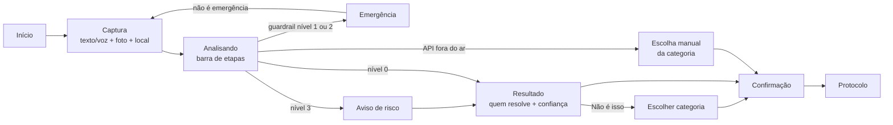

# Plano do Front-end: Quem Resolve?

> Versão **0.3** · 08/11/2026 · Ian · Alinhado ao design system (`docs/design-system/`). F0 em andamento.
> Base: PRD v0.4, `docs/CONTRATOS.md` v0.1 e o enunciado de Front-end (barema na seção 9).

O front é a vitrine da solução: é nele que **todas as matérias aparecem para quem avalia**. Por isso o plano deixa visível, em alguma tela, o resultado de cada disciplina, mesmo as que não são de Front.

---

## 1. Decisões de base

| Tema | Proposta | Por quê |
|---|---|---|
| Framework | **Next.js + TypeScript** (D05) | Aceito pelo professor; permite PWA e telas de verdade |
| Estilo | **Tailwind CSS** + componentes próprios | Rápido, e controlamos contraste e tamanho de toque |
| Gráficos | **Plotly** (`plotly.js` no navegador) (D13) | Exigência do enunciado: hover, zoom e filtros |
| Mapa | **Leaflet + OpenStreetMap** | Grátis, sem chave de API |
| Estado | Contexto React central em `state/` + `localStorage` | Histórico do cidadão sem cadastro e sem servidor |
| Comunicação | Só pela API FastAPI (`providers/api.ts`), URL em `NEXT_PUBLIC_API_URL` | O front nunca chama o LLM (3.1) |
| Deploy | Front na **Vercel**, API no **Render** (decidido), mais **docker-compose** | Cumpre a opção A e a B (diferencial: produção + Docker) |
| Idioma | pt-BR, linguagem simples, sem sigla de órgão sem explicação | Persona Dona Cida |

---

## 2. Estrutura de pastas (exigência 3.2)

```
web/
├─ src/app/            rotas do Next (só montam as features)
├─ src/features/       telas por responsabilidade
│  ├─ reportar/        captura, resultado, confirmação
│  ├─ emergencia/      tela do guardrail
│  ├─ assistente/      chat RAG
│  ├─ voz/             apertar para falar
│  ├─ ouviai/          alerta sonoro (IoT)
│  ├─ meus-reportes/   histórico do cidadão
│  └─ gestao/          mapa, filas, frota, métricas, qualidade da IA
├─ src/ui/             componentes visuais reutilizáveis
├─ src/state/          estado centralizado
└─ src/providers/      cliente HTTP da API + tipos dos contratos
```

---

## 3. Mapa de telas

Prioridade: **M** = obrigatório · **S** = importante · **C** = se der tempo

### 3.1 App do cidadão (mobile-first)

| Tela | O que mostra | Endpoint(s) | Matéria que aparece | Prior. |
|---|---|---|---|---|
| **Início** | Botão grande "Reportar problema", botão "Tenho uma dúvida", botão "Falar" | — | Front | M |
| **Reportar (captura)** | Descrição (texto ou ditado), foto opcional, localização automática com ajuste no mapa, validação dos campos | `/visao/detectar` | Front, VC | M |
| **Analisando** | Barra de etapas: "olhando a foto → entendendo o texto → descobrindo quem resolve" | `/reportes/analisar` | Front (design para latência) | M |
| **Resultado** | Categoria, **quem resolve**, canal, explicação simples, selo de confiança (cor + ícone + texto), "identificado por: foto / texto / IA", caixa na foto desenhada pelo `bbox`, botão **"Não é isso"**, botão "Ouvir" | — | Front (HITL), VC, GenAI | M |
| **Confirmação** | Resumo da solicitação, canal oficial direto como alternativa, botão "Enviar" | `POST /ocorrencias` | Front (HITL), RPA | M |
| **Protocolo** | Número do protocolo, o que acontece agora, "o e-mail foi enviado ao órgão" (quando o RPA marcar) | `GET /ocorrencias` | RPA | M |
| **Emergência** | Canal principal grande com ligação em um toque, outros canais, "não é uma emergência", **saída rápida** em violência doméstica | `/guardrail/avaliar` | GenAI, Governança | M |
| **Assistente (chat)** | Perguntas livres, resposta com **fonte citada**, aviso "não sei" quando não houver fonte | `/assistente/perguntar` | GenAI | M |
| **Voz** | Apertar para falar, transcrição, resposta em texto e áudio, aviso de consentimento | `/voz/conversar` | PLN | M |
| **Alerta OuviAí** | Faixa no topo de qualquer tela: "Sirene por perto" com ícone, cor e vibração | `GET /iot/eventos` | IoT | M |
| **Meus reportes** | Lista do que o cidadão já enviou (só neste aparelho) | estado local | Front (3.3) | M |
| **Avaliar resposta** | "Isso ajudou? 👍 👎" no fim do resultado e do chat | (novo, ver 10) | Front (HITL) | S |

### 3.2 Console da gestão

| Tela | O que mostra | Endpoint(s) | Matéria que aparece | Prior. |
|---|---|---|---|---|
| **Visão geral** | Indicadores (total, % fora da Prefeitura, taxa de correção) + **gráfico Plotly** + **2 filtros** (categoria e órgão) + filtro de origem | `/ocorrencias/metricas` | Front (3.6) | M |
| **Mapa** | Ocorrências por categoria; ícone diferente para cidadão, frota e ambos | `GET /ocorrencias` | Front, VC | M |
| **Filas** | Tabela por órgão, ordenada por prioridade, com selo de prioridade; gestor **reclassifica** ou muda o status | `GET /ocorrencias`, `PATCH .../status` | Front (HITL do gestor), RPA | M |
| **Frota** | Trajetos dos ônibus no mapa, detecções por trecho, FPS do processamento | `GET /frota/passagens` | VC, Cluster | S |
| **Qualidade da IA** | Latência da visão, confiança média, fila de baixa confiança, acionamentos do guardrail por nível, status dos módulos (mock ou real) | `/health`, `/guardrail/registros` | VC, GenAI, Governança | S |

> **Perfis (diferencial RBAC), decidido:** o cidadão usa sem cadastro. O console da gestão exige **login simples** (usuário e senha de demonstração, validados na API). Sem login, as rotas de gestão redirecionam para a tela de entrada.

---

## 4. Fluxo principal



---

## 5. Componentes reutilizáveis (exigência 3.6)

| Componente | Onde é usado |
|---|---|
| `Selo` (cor + ícone + texto) | Confiança, prioridade, risco, status, origem |
| `Botao` (primário, secundário, perigo) | Todas as telas |
| `Cartao` | Todas as telas |
| `GraficoPlotly` | Visão geral, frota, qualidade da IA (parâmetros diferentes) |
| `Mapa` | Captura (ajuste do ponto), mapa da gestão, frota |
| `Carregando`, `MensagemErro`, `Vazio` | Todos os estados de latência, erro e lista vazia |
| `SeletorCategoria` | Resultado ("não é isso"), escolha manual, reclassificação do gestor |
| `CanalEmergencia` | Tela de emergência e aviso de nível 3 |
| `FonteCitada` | Chat, voz, resultado |

---

## 6. Estado e cache (exigência 3.3)

- **Estado central** (`state/`): meus reportes, conversa do chat e da voz, preferências (alto contraste, tamanho da fonte), perfil (cidadão ou gestor).
- Salvo no **localStorage**, sem cadastro. Os níveis 1 e 2 do guardrail **nunca** entram no histórico.
- **Cache** no `providers/`: categorias e responsáveis são buscados uma vez só. Métricas ficam em cache por filtro e são refeitas ao mudar o filtro.
- O histórico alimenta "Meus reportes".

---

## 7. Falhas e validação (exigência 3.4)

| Situação | O que o cidadão vê |
|---|---|
| Campo vazio ou curto | Botão continua ativo; ao tocar, mensagem no próprio campo dizendo o que falta (o design system proíbe botão desabilitado) |
| Foto grande ou formato errado | "A foto passa de 8 MB" / "Envie JPG, PNG ou WEBP" |
| API fora do ar | "Não conseguimos falar com o servidor" + **escolha manual da categoria** + "ligue 156" |
| Demora (timeout de 15 s) | "Está demorando. Tente de novo." com botão |
| Erro do LLM | A API cai para as regras; se tudo falhar, escolha manual (RNF06) |
| Resposta inválida | "Recebemos uma resposta inesperada" sem detalhe técnico |
| Sem localização | Usa o centro de SP e pede para ajustar no mapa |
| Navegador sem voz | Esconde o microfone e explica que dá para digitar |

Segredos: nenhuma chave no front. Só `NEXT_PUBLIC_API_URL` no `.env.example`.

---

## 8. Acessibilidade (exigência 3.5, vai para o README)

- Contraste AA e modo **alto contraste**.
- Fonte **Atkinson Hyperlegible** (feita para baixa visão) e botão para aumentar a fonte.
- Alvos de toque de no mínimo 48 px. Uma ação principal por tela.
- Cor **nunca sozinha**: sempre com ícone e texto.
- Rótulo em todos os campos, foco visível, navegação por teclado, link "pular para o conteúdo".
- Leitura em voz alta da resposta e entrada por voz.
- Alerta do OuviAí visual e por vibração (deficiência auditiva).
- Verificação com **Lighthouse** e **axe** antes da entrega (diferencial: checklist WCAG verificado).

---

## 9. Barema da disciplina 04 → onde o plano atende

| Critério (nota) | Onde está |
|---|---|
| 1. Fluxo com IA (2,0) | Captura → `/reportes/analisar` (LLM com saída Pydantic na API) → resultado útil |
| 2. Arquitetura (2,0) | Pastas da seção 2 + API com `routers/ schemas/ pipelines/ providers/` |
| 3. Estado e robustez (1,5) | Seções 6 e 7, CORS restritivo, `.env.example` |
| 4. UX, acessibilidade e gráfico (2,0) | Seção 8, selo de confiança, HITL ("não é isso" + gestor), Plotly + 2 filtros, componentes da seção 5 |
| 5. Deploy e README (1,0) | Vercel + Render + docker-compose, README completo |
| 6. Validação e impacto (1,5) | Teste com 3 pessoas (mesma rodada do TTS do PLN), tabela com 3 casos de teste da IA, ODS 11 e 10 |
| Diferenciais | Produção + Docker, perfis cidadão/gestor, modelo próprio (YOLO da VC), pytest na API, acessibilidade avançada, PWA, identidade visual |

---

## 10. Ajustes nos contratos que o front pede

1. **Avaliar resposta (S):** `POST /feedback` com `{ "alvo": "reporte" | "assistente", "id": "...", "util": true }`, para o "Isso ajudou?". Entra no `CONTRATOS.md` v0.2 se aprovado.
2. **Reclassificar pelo gestor:** incluir `categoria_final` opcional no `PATCH /ocorrencias/{id}/status`.
3. **Login do gestor:** `POST /auth/login` com `{ "usuario": "...", "senha": "..." }` devolve `{ "token": "...", "nome": "Marina", "orgao_id": "subprefeitura" }`. As rotas de gestão (`PATCH .../status`, `/guardrail/registros`) passam a exigir o token. Senha só em variável de ambiente.

---

## 11. Ordem de construção

| Fase | Datas | Entrega | Usa mock? |
|---|---|---|---|
| F0 · Base | 07–08/11 | Projeto Next, pastas, paleta e fonte, componentes `Selo`, `Botao`, `Cartao`, estados; `providers/api.ts` com os tipos do contrato | API mock (passo 2) |
| F1 · Fluxo do cidadão | 08–10/11 | Início → captura → analisando → resultado (HITL) → confirmação → protocolo; escolha manual; meus reportes | Sim |
| F2 · Segurança e outras matérias | 10–12/11 | Emergência, chat do assistente, voz, alerta OuviAí | Sim, até o parceiro entregar RAG e voz |
| F3 · Console | 12–14/11 | Visão geral com Plotly + filtros, mapa, filas com reclassificação, frota | Dados simulados + frota real quando o processador ficar pronto |
| F4 · Acabamento | 15–17/11 | Qualidade da IA, acessibilidade (Lighthouse/axe), PWA, deploy, docker-compose, teste com 3 pessoas, README | Troca para os módulos reais |
| F5 · Vídeo | 18/11 | Vídeo de 5 min do Front | — |

---

## 11b. Ajustes do design system (08/11)

| Tema | Decisão |
|---|---|
| Visual | Segue o design system "Quem Resolve?" (vidro fosco, verde-floresta, Atkinson Hyperlegible Next, 3 temas). Cópia em `docs/design-system/`. |
| Navegação do cidadão | Dock com **Reportar · Tirar dúvida · Meus reportes** (sem "Conta" nem "Perto de mim"). |
| Selo de confiança | Alta ≥ 80% · média 50–79% · baixa < 50%. Abaixo de 50% o app pede confirmação. |
| Botão desabilitado | Não usar: o botão fica ativo e explica o que falta. |

## 12. Decisões do Ian (07/11)

| # | Pergunta | Decisão |
|---|---|---|
| 1 | Perfis | **Login simples para o gestor.** Cidadão continua sem cadastro. |
| 2 | Telas C (roadmap quântico, gráfico pessoal) | **Ficam de fora.** O roadmap quântico fica só no documento da matéria. |
| 3 | Identidade visual | **Em aberto.** Ian vai criar no Claude Design. |
| 4 | Deploy | **Vercel (front) + Render (API)**, mais docker-compose. |
| 5 | Ajustes da seção 10 | **Aprovados**, incluindo o login (`POST /auth/login`). Já estão no `CONTRATOS.md` v0.2. |
