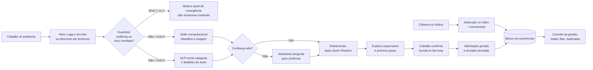
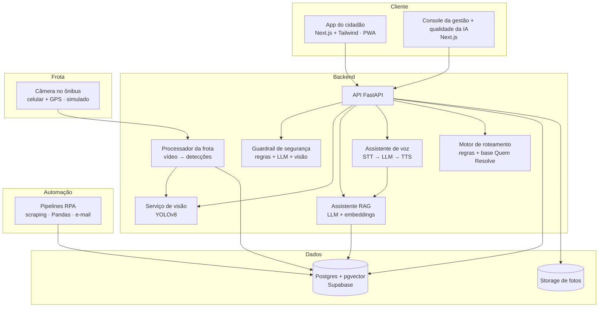
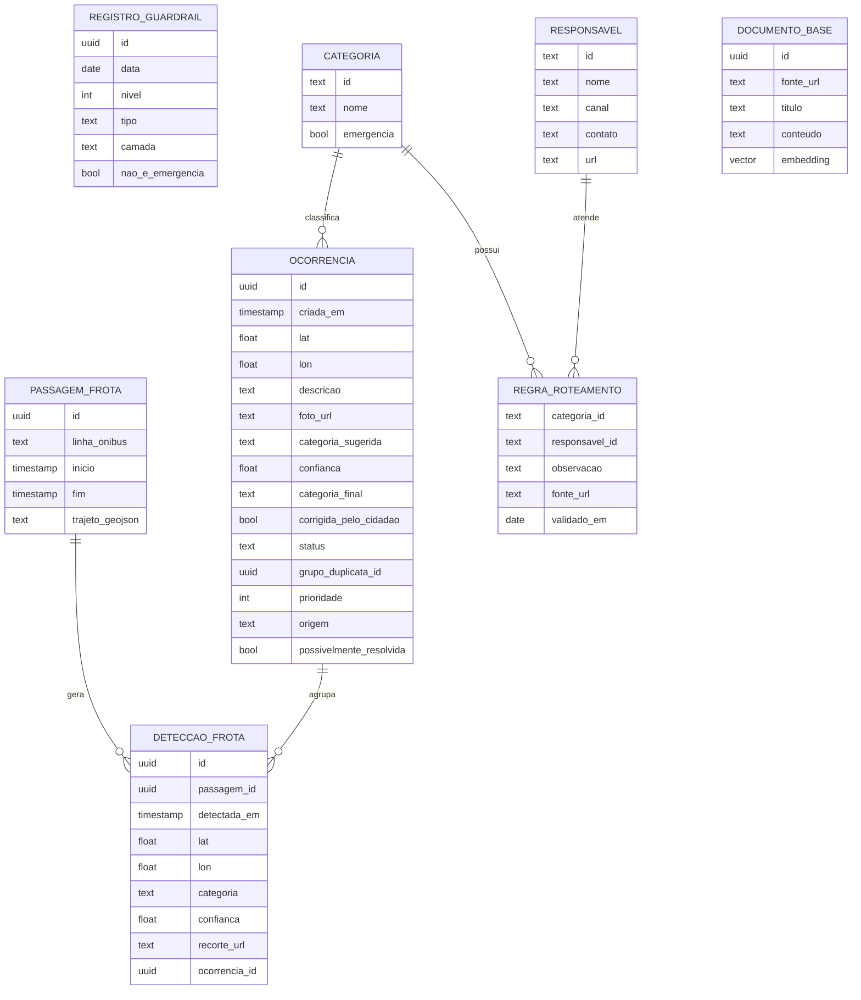

# PRD — Quem Resolve?

> Roteador inteligente de problemas de zeladoria e limpeza urbana para São Paulo.
> Global Solution 2026.2 · FIAP · 2TIA · Desafio CitizenTech

| Campo | Valor |
|---|---|
| Status | 🟡 Rascunho v0.4 |
| Dupla | Ian · Parceiro *(preencher nome)* |
| Última atualização | 06/11/2026 |
| Entrega das disciplinas | **19/11/2026 às 23h55** (Portal do Aluno) |
| Entrega Challenge Sprint | 30/11/2026 |
| Repositório | `github.com/<org>/<repo>` *(preencher)* |

**Como usar este documento:** ele é a fonte da verdade do projeto. Toda decisão relevante entra na seção [Registro de decisões](#17-registro-de-decisões). Mudanças de escopo passam por PR com revisão da dupla. Itens marcados com ⚠️ ainda precisam ser validados.

---

## 1. Problema

Em São Paulo, quem encontra um problema urbano (buraco, fio caído, poste danificado, vazamento, lixo acumulado, descarte irregular, boca de lobo entupida, calçada quebrada) **não sabe a quem recorrer**. A responsabilidade é fragmentada entre Prefeitura, subprefeituras, concessionárias de coleta de lixo, CET, Enel, Sabesp, Comgás, operadoras de telecom e até proprietários de imóveis.

Além disso, o modelo atual é **reativo**: a cidade só fica sabendo de um problema quando alguém se dá ao trabalho de reportar. Lixo acumulado e bueiros entupidos costumam ser percebidos só quando já causaram alagamento ou mau cheiro.

O resultado aparece dos dois lados:

- **Cidadão:** desiste de reportar, reporta no lugar errado ou entra no "pingue-pongue" entre órgãos. O problema continua na rua.
- **Gestão pública:** o SP156 recebe mais de 1 milhão de solicitações por ano, distribuídas em cerca de 200 categorias. Parte delas está fora da competência da Prefeitura, mal descrita, sem foto ou duplicada, o que gera retrabalho de triagem.

### Evidências (desk research)

| Evidência | Fonte |
|---|---|
| Na CPI da Fiação (Câmara Municipal de SP), foi dito que o munícipe que vê um fio caído não sabe quem chamar, e foi sugerida identificação dos fios por QR Code ou cor. | [Câmara Municipal de SP](https://www.saopaulo.sp.leg.br/blog/cpi-da-fiacao-aprova-pedido-de-informacoes-sobre-zeladoria-e-fornecimento-de-energia-na-capital) |
| Cada poste tem pontos compartilhados alugados pela Enel a operadoras de telecom, o que multiplica os possíveis responsáveis por um mesmo fio. | [Câmara Municipal de SP](https://www.saopaulo.sp.leg.br/blog/representantes-da-enel-anatel-e-sp-regula-sao-ouvidos-pela-cpi-da-fiacao/) |
| A orientação oficial é fragmentada: fio soltando faísca vai para a Enel, vandalismo em poste vai para a Polícia, iluminação de rua vai para a Prefeitura. | [SP Regula – FAQ Iluminação](https://prefeitura.sp.gov.br/web/spregula/w/iluminacao_publica/perguntas_frequentes/4613) |
| Defesa do consumidor descreveu a Prefeitura e a concessionária de energia "jogando" a reclamação uma para a outra. *(matéria de 2017)* | [IstoÉ Dinheiro / Estadão](https://istoedinheiro.com.br/queixas-de-zeladoria-lideram-50-sao-atendidas) |
| O SP156 recebeu cerca de 1,126 milhão de solicitações em 2019, em cerca de 200 categorias. | [Câmara Municipal – Boletim SP156](https://saopaulo.sp.leg.br/antigo/wp-content/uploads/2020/07/BOLETIM-CTTAE-BU-EST-PROF-156-02-19.pdf) |
| Em pedidos de informação (LAI) de março/2025, a maior parte dos indeferimentos foi por estar fora do escopo ou fora da competência da Prefeitura. Indício do mesmo padrão. | [Relatório Transparência Passiva mar/2025](https://capital.sp.gov.br/documents/d/ouvidoria/relatorio-transparencia-passiva-mar-2025-pdf) |
| Os dados do SP156 são abertos, anonimizados e georreferenciados (Portal de Dados Abertos e GeoSampa). | [Dados Abertos SP156](http://dados.prefeitura.sp.gov.br/dataset/dados-do-sp156) |

### Problem statement

> **Moradores de São Paulo** que encontram um problema no espaço público **não sabem quem é o responsável nem como acionar o canal certo**, o que gera desistência, demora e retrabalho para os órgãos públicos. **Como poderíamos** fazer com que cada ocorrência chegue, já qualificada, ao responsável certo na primeira tentativa, e que a cidade detecte problemas antes mesmo de alguém reportar?

---

## 2. Objetivos e não-objetivos

### Objetivos

1. **O cidadão descobre quem resolve em menos de 1 minuto**, a partir de uma foto e/ou descrição em linguagem natural.
2. **A ocorrência sai qualificada**: categoria, localização, foto, descrição e órgão responsável, prontos para envio.
3. **A gestão enxerga o território**: painel com ocorrências classificadas, deduplicadas e priorizadas.
4. **Funciona para todos**: acessível para pessoas com baixa familiaridade digital, idosos e pessoas com deficiência.
5. **Custo de operação próximo de zero** no protótipo, usando apenas ferramentas open source e free tiers.
6. **A cidade detecta problemas sozinha**: câmeras embarcadas em ônibus identificam lixo, buracos e bueiros entupidos ao longo das rotas.
7. **Emergências nunca ficam presas no fluxo**: violência e risco imediato são desviados na hora para o canal de emergência certo.

### Não-objetivos (fora de escopo)

- Substituir o SP156 ou os canais das concessionárias. O produto fica **na frente** deles.
- Integração real com sistemas da Prefeitura ou das concessionárias. O envio é **simulado** (e-mail automatizado para caixas de teste).
- Acompanhamento real do status da solicitação após o envio.
- Cobrar do cidadão.
- **Tratar violência ou emergências como ocorrência roteável.** Elas são tratadas pelo guardrail de segurança (seção 4.2), que orienta e não armazena conteúdo.
- **Câmeras fixas ou monitoramento contínuo de um mesmo local.** A detecção é feita por câmeras em movimento, e o vídeo é descartado (seção 4.1).
- Integração real com a frota da SPTrans. A câmera embarcada é **simulada** com vídeos gravados por celular.

---

## 3. Personas

**Dona Cida, 64 anos, Zona Leste.** Usa WhatsApp todo dia, mas trava em sites e formulários. Viu um fio pendurado na frente da casa da vizinha e não sabe se liga pra Enel, pra Prefeitura ou pra Polícia. Precisa de algo simples, com texto grande e que funcione por voz.

**Rafael, 29 anos, ciclista, Pinheiros.** Desvia de buracos e calçadas quebradas todo dia. Já reportou no 156 e nunca soube o que aconteceu. Quer reportar em segundos, com foto, sem preencher cadastro longo.

**Marina, 41 anos, servidora de subprefeitura.** Recebe demandas duplicadas, sem foto e fora da competência dela. Gasta tempo triando em vez de resolvendo. Quer ver o que é dela, priorizado, com evidência.

---

## 4. Visão da solução

O cidadão **tira uma foto e/ou descreve o problema**. A IA:

1. **Identifica o tipo de problema** pela imagem (visão computacional).
2. **Entende a descrição** e tira dúvidas em conversa (assistente com RAG).
3. **Determina o responsável** usando a base "Quem resolve o quê".
4. **Explica em linguagem simples** o que fazer e por quê.
5. **Gera a solicitação pronta** e a encaminha (simulado) ao canal correto.

A gestão acessa um **console** com mapa, filas por órgão, duplicatas agrupadas e prioridade.

O produto tem **duas portas de entrada** que alimentam o mesmo roteamento:

- **Porta 1, cidadão:** reporte por foto, texto ou voz no app.
- **Porta 2, frota:** câmeras embarcadas em ônibus detectam problemas automaticamente ao longo das rotas.

E uma camada transversal de proteção: o **guardrail de segurança**, que intercepta violência e emergências antes de qualquer roteamento.

### Fluxo principal

### 4.1 Porta 2: detecção embarcada em ônibus

**Ideia:** em vez de instalar câmeras fixas, usar veículos que já percorrem a cidade todos os dias. Ônibus passam pelas principais vias repetidamente, então poucas câmeras cobrem muitas ruas, várias vezes por semana.

**Como funciona:**

1. Uma câmera simples (no protótipo, um celular no para-brisa) grava o trajeto com GPS.
2. O modelo de visão processa os quadros e detecta problemas: lixo acumulado, descarte irregular, buraco, boca de lobo entupida, esgoto, poste apagado.
3. Rostos e placas são borrados **antes** de qualquer armazenamento. O vídeo bruto é **descartado**; só ficam as detecções (categoria, localização, recorte da imagem do problema, confiança, horário).
4. Um rastreador de objetos evita contar o mesmo problema várias vezes no mesmo trajeto.
5. As detecções entram na **mesma base** dos reportes dos cidadãos. Se a frota detectou e um cidadão também reportou, vira **uma ocorrência só**, com prioridade maior.
6. A cada nova passagem do ônibus, o sistema verifica se o problema ainda está lá. Se sumiu, a ocorrência é marcada como **possivelmente resolvida**.

**Por que ônibus e não câmera fixa:** custo muito menor por rua coberta, cobertura de toda a rota e menor risco de vigilância, porque a câmera passa e vai embora, sem observar o mesmo lugar continuamente.

**No protótipo:** vídeos gravados pela dupla com celular em trechos reais de SP, com GPS do próprio celular, processados em lote para simular a frota.

### 4.2 Guardrail de segurança

Violência e emergências **não são categorias roteáveis**. Quando o texto, a voz ou a foto indicam esse tipo de situação, o guardrail interrompe o fluxo normal.

| Nível | Quando | O que o app faz | Armazena conteúdo? |
|---|---|---|---|
| **1. Risco imediato** | Pessoa em perigo agora, fogo, pessoa ferida, cheiro de gás, fio faiscando | Interrompe tudo e mostra **um** canal em destaque com ligação em um toque, e os demais abaixo | Não |
| **2. Violência sem risco imediato** | Assalto já ocorrido, relato de violência doméstica, violação de direitos | Orienta: Delegacia Eletrônica para boletim de ocorrência, 180, Disque 100 | Não |
| **3. Zeladoria com risco** | Árvore prestes a cair, buraco grande, fio faiscando na rua | Mostra o canal de emergência primeiro, mas **permite continuar** o reporte | Sim, como ocorrência normal |

**Canais de emergência (embutidos no app, funcionam sem internet):**

| Canal | Número | Quando |
|---|---|---|
| Polícia Militar | 190 | Crime acontecendo, pessoa em perigo |
| SAMU | 192 | Pessoa ferida ou passando mal |
| Bombeiros | 193 | Fogo, resgate |
| Defesa Civil | 199 | Desabamento, alagamento, risco estrutural |
| Central de Atendimento à Mulher | 180 | Violência contra a mulher |
| Disque Direitos Humanos | 100 | Violência contra crianças, idosos, pessoas com deficiência e outras violações |
| Emergências de energia e gás | Enel / Comgás ⚠️ validar números | Fio faiscando, cheiro de gás |

**Detecção em camadas** (qualquer camada que disparar ativa o guardrail):

1. **Regras e palavras-chave** em português, incluindo gírias e erros de digitação. Rápido, barato e explicável.
2. **Classificador com LLM** com saída estruturada (nível, tipo e justificativa curta) para o que as regras não pegam.
3. **Visão computacional** com classes de risco (fogo, fumaça, pessoa caída).

**Princípios:**

- **Preferir falso positivo.** É melhor mostrar o 190 sem necessidade do que deixar passar uma emergência. Sempre há a opção "não é uma emergência, continuar".
- **Discrição em violência doméstica.** Tela sem alarde e sem som, com botão de **saída rápida** para uma tela neutra.
- **Linguagem acolhedora**, sem julgamento e sem pedir detalhes.
- **Registro anônimo de acionamento** (ver D08): guarda apenas data, nível, tipo, camada que detectou e se a pessoa clicou "não é emergência". **Nunca** texto, foto, localização ou identificador do dispositivo.

---

## 5. Experiência do usuário

### App do cidadão (mobile-first, PWA)

| Tela | Conteúdo |
|---|---|
| **Início** | Um botão principal "Reportar problema" (câmera) e um secundário "Tenho uma dúvida". Sem cadastro obrigatório. |
| **Captura** | Foto, localização automática (com opção de ajuste no mapa) e campo de descrição por texto ou voz. |
| **Resultado** | "Isso parece ser **fiação de telecom solta**. Quem resolve: **operadora dona do cabo**. A Prefeitura fiscaliza." Com explicação curta, nível de confiança e botão "Não é isso". |
| **Confirmação** | Resumo da solicitação gerada, canal de destino e botão "Enviar". Mostra também o canal oficial direto (telefone e link) como alternativa. |
| **Guardrail** | Tela de emergência com canal principal em destaque, ligação em um toque, demais canais abaixo, botão "não é uma emergência, continuar" e, para violência doméstica, botão de saída rápida. |
| **Assistente** | Chat para dúvidas ("de quem é a calçada?", "o que faço se o fio está soltando faísca?"), sempre com fonte citada. |

### Console da gestão

| Tela | Conteúdo |
|---|---|
| **Mapa** | Ocorrências por categoria e órgão responsável, com clusters. |
| **Filas** | Lista por órgão, ordenada por prioridade (risco, recorrência, tempo aberto). |
| **Duplicatas** | Ocorrências próximas e semelhantes agrupadas automaticamente, inclusive entre cidadão e frota. |
| **Frota** | Trajetos percorridos pelos ônibus, detecções por trecho, cobertura (ruas vistas nos últimos 7 dias) e ocorrências possivelmente resolvidas. |
| **Métricas** | Volume por categoria e região, taxa de reclassificação pelo cidadão, % fora da competência da Prefeitura. |
| **Qualidade da IA** | Desempenho dos modelos (matriz de confusão, confiança média, latência), fila de revisão humana das classificações de baixa confiança, resultados dos testes do assistente e métricas do guardrail (acionamentos por nível e taxa de "não é emergência"). |

### Princípios de design

- **Uma ação por tela.** Linguagem simples, sem jargão de órgão público.
- **Acessibilidade WCAG 2.1 AA**: contraste, alvos de toque grandes, leitor de tela, entrada por voz, cores semânticas sempre acompanhadas de texto ou ícone.
- **Transparência da IA**: sempre mostrar o nível de confiança e permitir corrigir.
- **Emergência primeiro**: se houver risco imediato, o guardrail (seção 4.2) mostra o canal de emergência antes de qualquer outra coisa.

---

## 6. Requisitos funcionais

Prioridade: **M** = must · **S** = should · **C** = could

### Cidadão

| ID | Requisito | Prior. |
|---|---|---|
| RF01 | Enviar foto pela câmera ou galeria | M |
| RF02 | Capturar localização automaticamente, com ajuste manual no mapa | M |
| RF03 | Descrever o problema por texto | M |
| RF04 | Descrever o problema por voz (speech-to-text) | M |
| RF05 | Receber categoria sugerida, responsável e explicação, com nível de confiança | M |
| RF06 | Corrigir a categoria sugerida (human-in-the-loop) | M |
| RF07 | Ver alerta de emergência quando a categoria indicar risco | M |
| RF08 | Gerar e "enviar" a solicitação formatada para o canal correto | M |
| RF09 | Conversar com o assistente sobre responsabilidades e serviços, com fonte citada | M |
| RF10 | Borrar automaticamente rostos e placas antes de salvar a foto | S |
| RF11 | Acompanhar as próprias ocorrências enviadas | C |
| RF12 | Ouvir a resposta (responsável e próximo passo) em áudio, além do texto | M |

### Guardrail de segurança

| ID | Requisito | Prior. |
|---|---|---|
| RF40 | Detectar violência e risco imediato no texto por regras e palavras-chave | M |
| RF41 | Detectar violência e risco imediato com classificador LLM (nível, tipo, justificativa) | M |
| RF42 | Detectar risco na imagem (fogo, fumaça, pessoa caída) | C |
| RF43 | Exibir tela de emergência com canal principal e ligação em um toque, nos 3 níveis | M |
| RF44 | Permitir "não é uma emergência, continuar" | M |
| RF45 | Botão de saída rápida em casos de violência doméstica | M |
| RF46 | Não armazenar texto, foto ou localização quando nível 1 ou 2 | M |
| RF47 | Gravar registro anônimo do acionamento (D08) | M |
| RF48 | Canais de emergência embutidos no app, disponíveis offline | M |

### Detecção embarcada (frota)

| ID | Requisito | Prior. |
|---|---|---|
| RF50 | Processar vídeo com GPS e extrair quadros em intervalo configurável | M |
| RF51 | Detectar danos no pavimento (buraco e fissuras) nos quadros, com o modelo avaliado em VC (D12) | M |
| RF51b | Detectar também lixo, descarte irregular e boca de lobo entupida (extra) | S |
| RF52 | Borrar rostos e placas antes de armazenar qualquer imagem; descartar o vídeo bruto | M |
| RF53 | Rastrear objetos entre quadros para não duplicar a mesma detecção | C |
| RF54 | Associar detecções da frota a ocorrências existentes (cidadão ou frota) por proximidade e categoria | M |
| RF55 | Marcar ocorrência como "possivelmente resolvida" quando nova passagem não detectar o problema | C |
| RF56 | Simular a frota com vídeos gravados pela dupla e um gerador de trajetos | M |

### Assistente de voz (disciplina 08)

| ID | Requisito | Prior. |
|---|---|---|
| RF60 | Capturar áudio por "apertar para falar" e aceitar upload de arquivo de áudio | M |
| RF61 | Transcrever em português (STT) em módulo separado | M |
| RF62 | Responder com o LLM + base "Quem Resolve" (mesmo RAG da GenAI), com memória da conversa para perguntas de continuação | M |
| RF63 | Adaptar a resposta para fala (frases curtas, sem markdown, números e siglas pronunciáveis) e sintetizar em pt-BR (TTS) | M |
| RF64 | Exibir transcrição e resposta em texto junto do áudio | M |
| RF65 | Registrar a latência de cada etapa e o tempo total até o início da fala | M |
| RF66 | Avisar o consentimento antes do primeiro uso e descartar o áudio após a transcrição | M |
| RF67 | Recusar pedidos fora do tema e dizer "não sei" quando não houver fonte | M |

### Gestão

| ID | Requisito | Prior. |
|---|---|---|
| RF20 | Visualizar ocorrências em mapa com filtros por categoria, órgão e período | M |
| RF21 | Ver filas por órgão responsável, ordenadas por prioridade | M |
| RF22 | Agrupar duplicatas por proximidade geográfica e similaridade | S |
| RF23 | Ver painel de métricas com ao menos 1 gráfico Plotly interativo (hover/zoom) e 2 filtros | M |
| RF24 | Revisar e reclassificar ocorrências | S |
| RF25 | Visualizar trajetos da frota, cobertura e detecções por trecho | M |
| RF26 | Diferenciar no mapa a origem da ocorrência (cidadão, frota ou ambos) | M |

### Base de conhecimento e automação

| ID | Requisito | Prior. |
|---|---|---|
| RF30 | Coletar automaticamente Carta de Serviços do SP156 e FAQs de órgãos e concessionárias (scraping) | M |
| RF31 | Limpar e normalizar os textos coletados e indexá-los na base do RAG | M |
| RF31b | Gerar 3 corpus (conversacional, perguntas e respostas, texto puro) a partir das fontes | C (D11) |
| RF32 | Manter a tabela "Quem resolve o quê" versionada no repositório | M |
| RF33 | Enviar e-mail automatizado simulando o encaminhamento ao órgão | M |
| RF34 | Gerar ocorrências simuladas realistas para testes e demo | M |
| RF35 | Incluir categorias de limpeza urbana na base de roteamento (coleta, descarte irregular, boca de lobo, lixeira pública, varrição) | M |

---

## 7. Requisitos não funcionais

| ID | Requisito |
|---|---|
| RNF01 | Classificação da imagem em menos de 3 s (p95) no servidor gratuito |
| RNF02 | Resposta do assistente em menos de 6 s (p95) |
| RNF03 | Acessibilidade WCAG 2.1 AA nas telas do cidadão |
| RNF04 | LGPD: sem cadastro obrigatório, minimização de dados, borramento de rostos e placas, retenção definida |
| RNF05 | Custo mensal de infraestrutura do protótipo = R$ 0 |
| RNF06 | Resiliência: se a IA falhar, o cidadão ainda consegue escolher a categoria manualmente |
| RNF07 | Toda resposta do assistente cita a fonte da base de conhecimento; sem fonte, ele diz que não sabe |
| RNF08 | Guardrail decide em menos de 1 s, e as regras locais funcionam mesmo se a API de LLM estiver fora do ar |
| RNF09 | Processamento de vídeo da frota a pelo menos 5 quadros por segundo em GPU gratuita (Colab) ⚠️ calibrar |
| RNF10 | Nenhum vídeo bruto da frota é persistido; só recortes já borrados |
| RNF11 | Áudio de voz do cidadão não é armazenado após a transcrição |
| RNF12 | Front e API em camadas: front com `features/ ui/ state/ providers/`, API com `routers/ schemas/ pipelines/ providers/`; LLM chamado só no back-end, com saída Pydantic; CORS restritivo; `.env.example` (exigências da disciplina 04) |

---

## 8. Arquitetura e stack

> **Front-end:** o professor da disciplina 04 confirmou que não é obrigatório usar Streamlit ou Gradio (ver D05). Todo o front é em **Next.js**: app do cidadão e console da gestão, que inclui também a área de qualidade da IA (avaliação dos modelos, revisão humana e gráficos).
>
> O resto do enunciado da disciplina 04 continua valendo: arquitetura em camadas (RNF12), gráfico **Plotly** com 2 filtros (D13), human-in-the-loop, tratamento de falhas, deploy e **teste com 3 pessoas** + 3 casos de teste da IA no README (D14).

### Stack (custo zero)

| Camada | Tecnologia | Hospedagem |
|---|---|---|
| App do cidadão e console da gestão | Next.js, TypeScript, Tailwind, shadcn/ui, Leaflet + OpenStreetMap, **Plotly (react-plotly.js)** para os gráficos (D13) | Vercel (free) |
| API | FastAPI (Python) | Hugging Face Spaces (Docker) ou Render (free) |
| Visão computacional | YOLOv8 (Ultralytics) pré-treinado, fine-tuning em amostra do **RDD2022** no Google Colab (D12) | Embutido na API |
| Frota (vídeo) | OpenCV, rastreador ByteTrack (Ultralytics), borramento com detector de rostos/placas | Processamento em lote no Colab |
| Guardrail | Regras em Python + LLM com saída JSON | Embutido na API (regras também no front) |
| LLM | API com free tier (Gemini ou Groq) ⚠️ verificar limites atuais | — |
| Voz | STT: faster-whisper (comparar 2 tamanhos, ex.: small × medium); TTS: edge-tts ou Piper (pt-BR) | Embutido na API / Colab |
| Embeddings e busca | sentence-transformers multilíngue + pgvector | Supabase (free) |
| Banco e storage | Postgres + Storage | Supabase (free) |
| RPA | Python, requests/BeautifulSoup ou Playwright, Pandas, smtplib | GitHub Actions (free) |
| IoT | Edge Impulse (MFE + CNN) + celular como sensor; classes sirene, buzina e ambiente (D15) | Edge Impulse (free) |
| Cluster | Simulador iSPD (2 × 4 workers, D16) | Local |

⚠️ Free tiers mudam com frequência. Validar limites antes de 08/11.

---

## 9. Mapa disciplinas → módulos → entregáveis

| # | Disciplina | Módulo no produto | Entregável mínimo | Dono |
|---|---|---|---|---|
| 01 | AI for RPA | Pipelines de coleta e automação | Robô ponta a ponta com ≥ 3 temas (scraping, Pandas, SQL, e-mail), quadro de temas, log e caminho seguro em falhas, evidências com amostra rotulada e 1 falha tratada | Parceiro |
| 02 | Cluster Computing | Processamento de vídeo da frota | Relatório de 2 a 4 páginas: mesma carga (vídeo de N ônibus) simulada no iSPD com **2 e 4 workers**, mudando só isso; Total Simulated Time, uso dos workers, redução % e T2/T4 | **Ian** |
| 03 | Computação Quântica | Roadmap de otimização | Gargalo real (escolher quais ônibus equipar / rotear equipes / priorizar fila), capacidade quântica (otimização), roadmap clássico → quântico com ética, LGPD e ODS. Sem código | Parceiro |
| 04 | Front End & Mobile | App do cidadão + console da gestão (Next.js) + API FastAPI | Camadas exigidas, LLM com saída Pydantic, estado/cache, falhas, UX acessível, HITL, Plotly + 2 filtros, componente reutilizável, deploy, README com teste de 3 pessoas e 3 casos de teste da IA, vídeo de 5 min | **Ian** |
| 05 | Generative AI | Assistente RAG "Quem Resolve?" + classificador do guardrail | Chunking, retriever e generator justificados; ≥ 10 perguntas de teste; ≥ 2 testes adversariais; avaliação por componente e end-to-end; vídeo de 5 min | Parceiro |
| 06 | Governança em IA | Integração + IA responsável | Avaliada à parte. Documentação ABNT, vídeo de até 7 min e GitHub, com guardrail, privacidade da frota e registro anônimo em destaque | Parceiro (com apoio do Ian no vídeo) |
| 07 | Physical Computing / IoT | Módulo de acessibilidade sonora | Edge Impulse com **sirene, buzina e ambiente**; 20 gravações de 5 s por classe (15 treino / 5 teste); matriz de confusão; **15 tentativas ao vivo** no celular | **Ian** |
| 08 | NLP & Chatbots | **Assistente de voz** (D11) | STT → LLM (com RAG e memória) → TTS; WER em 20 áudios; 30 perguntas; TTS avaliado por 3 pessoas; latência em 10 conversas; comparar 2 opções; relatório PDF; vídeo de 5 min com conversa de 3 turnos | Parceiro |
| 09 | Visão Computacional | Detector de danos no pavimento (cidadão + frota) | YOLOv8 em amostra do RDD2022; precisão, recall, mAP; análise de erros; latência por imagem e FPS em vídeo da frota; integração no app; relatório breve | **Ian** |

> Divisão definida pelo Ian em 06/11.

---

## 10. Modelo de dados (inicial)

---

## 11. Base "Quem resolve o quê" (v0)

Esta tabela é o coração do roteamento. **Cada linha precisa de fonte oficial antes de ir para produção.** Hoje está como ⚠️ a validar.

| Categoria | Exemplo | Responsável | Canal | Emergência? | Status |
|---|---|---|---|---|---|
| Buraco na via | Buraco no asfalto | Prefeitura (subprefeitura) | SP156 | Não | ⚠️ |
| Iluminação pública | Lâmpada de rua apagada | Prefeitura | SP156 | Não | ⚠️ |
| Fio de energia caído / faiscando | Fio no chão soltando faísca | Enel | Telefone de emergência da Enel | **Sim** | ⚠️ |
| Fiação de telecom solta | Cabo pendurado sem energia | Operadora dona do cabo · Prefeitura fiscaliza | Operadora / SP156 | Não | ⚠️ |
| Poste danificado | Poste inclinado ou quebrado | Enel | Canais da Enel | Depende | ⚠️ |
| Vandalismo ou furto de fios | Fios sendo cortados | Polícia | 190 | **Sim** | ⚠️ |
| Vazamento de água na rua | Água jorrando da calçada | Sabesp | Canais da Sabesp | Depende | ⚠️ |
| Esgoto | Esgoto a céu aberto | Sabesp | Canais da Sabesp | Não | ⚠️ |
| Cheiro de gás | Cheiro forte de gás na rua | Comgás | Telefone de emergência da Comgás | **Sim** | ⚠️ |
| Calçada quebrada | Calçada em frente a imóvel | Proprietário do imóvel · subprefeitura fiscaliza | SP156 | Não | ⚠️ |
| Árvore (poda / queda) | Galho ameaçando cair | Subprefeitura | SP156 · 199 Defesa Civil se risco | Depende | ⚠️ |
| Árvore sobre fiação | Galho encostado em fio | Enel + subprefeitura | Enel / SP156 | Depende | ⚠️ |
| Semáforo com defeito | Semáforo apagado | CET | SP156 | Não | ⚠️ |
| Descarte irregular / entulho | Entulho ou sofá na calçada | Prefeitura (subprefeitura) | SP156 | Não | ⚠️ |
| Coleta de lixo não realizada | Caminhão não passou no dia | Concessionária de coleta · fiscalização municipal | SP156 | Não | ⚠️ |
| Lixo acumulado em via pública | Sacos de lixo espalhados na esquina | Prefeitura (subprefeitura) | SP156 | Não | ⚠️ |
| Boca de lobo entupida | Bueiro cheio de lixo | Prefeitura (subprefeitura) | SP156 · 199 se alagando | Depende | ⚠️ |
| Lixeira pública | Lixeira quebrada ou transbordando | Prefeitura | SP156 | Não | ⚠️ |
| Varrição | Rua sem varrição | Prefeitura | SP156 | Não | ⚠️ |
| Veículo abandonado | Carro parado há meses | Prefeitura | SP156 | Não | ⚠️ |
| Alagamento | Rua alagada | Defesa Civil / subprefeitura | 199 / SP156 | Depende | ⚠️ |

> **Violência e emergências não estão nesta tabela.** Elas não são roteadas: são tratadas pelo guardrail de segurança (seção 4.2).

---

## 12. IA responsável e LGPD

- **Minimização:** sem cadastro obrigatório. Localização usada só para a ocorrência.
- **Fotos:** borrar rostos e placas antes de armazenar (RF10). Metadados EXIF removidos.
- **Retenção:** fotos apagadas após X dias no protótipo ⚠️ definir.
- **Transparência:** toda classificação mostra a confiança e pode ser corrigida pelo cidadão.
- **Alucinação:** o assistente só responde com base em documentos recuperados e cita a fonte. Sem fonte, ele diz que não sabe e indica o SP156.
- **Viés territorial:** monitorar se a qualidade da classificação varia entre regiões (ex.: fotos de periferia vs. centro) e se o painel não "esconde" áreas com menos reportes.
- **Segurança:** em categorias de emergência, o produto nunca substitui os canais oficiais de emergência.
- **Guardrail:** em violência e risco imediato, nenhum conteúdo é armazenado. Só existe o registro anônimo de acionamento (D08), sem texto, foto, localização ou identificador.
- **Frota:** câmeras em movimento, sem monitoramento contínuo de um mesmo local. Rostos e placas borrados antes do armazenamento, vídeo bruto descartado, sem reconhecimento facial nem identificação de pessoas, em nenhuma hipótese.
- **Viés da frota:** a cobertura depende das rotas de ônibus. Ruas sem ônibus (vielas, áreas de difícil acesso) ficam menos cobertas e dependem mais dos reportes de cidadãos. O painel mostra a cobertura explicitamente para que a gestão não confunda "sem detecção" com "sem problema".

---

## 13. Métricas de sucesso

### Produto

| Métrica | Meta do protótipo |
|---|---|
| Tempo do cidadão da abertura até a solicitação gerada | < 60 s |
| Taxa de roteamento correto (conjunto de teste rotulado) | ≥ 90% |
| Taxa de correção pelo cidadão | Monitorar (indica qualidade do modelo) |
| Duplicatas agrupadas corretamente | ≥ 80% |
| Ocorrências detectadas pela frota antes de qualquer reporte de cidadão | Monitorar |
| Taxa de "não é emergência" no guardrail | Monitorar (indica excesso de falsos positivos) |

### Modelos

| Modelo | Métrica | Meta |
|---|---|---|
| Visão | mAP@50 no conjunto de teste | ≥ 0,6 ⚠️ calibrar após escolher dataset |
| Visão | Latência por imagem (CPU) | < 1 s |
| Assistente | Respostas corretas e fundamentadas (conjunto de 30–50 perguntas) | ≥ 85% |
| Assistente | Afirmações sem fonte | < 5% |
| Visão (frota) | Quadros por segundo no processamento de vídeo | ≥ 5 ⚠️ calibrar |
| Guardrail | Recall dos níveis 1 e 2 (conjunto de 50–100 mensagens rotuladas) | ≥ 98% |
| Guardrail | Precisão | Monitorar, aceitando falsos positivos |
| Áudio (IoT) | Acurácia nas 15 tentativas ao vivo | ≥ 80% |
| Voz (STT) | WER em 20 áudios (3 vozes, 5 com ruído) | ≤ 15% ⚠️ calibrar |
| Voz (ponta a ponta) | Tempo da pergunta até o início da fala | < 6 s ⚠️ calibrar |

---

## 14. Viabilidade

- **Custo de infraestrutura:** R$ 0 no protótipo, só com open source e free tiers.
- **Custo de implantação real:** baixo. O produto não cria canal novo nem exige integração pesada; ele qualifica e direciona a demanda para canais que já existem.
- **Dados:** a base de conhecimento vem de fontes públicas (Carta de Serviços, FAQs oficiais). Os dados do SP156 são abertos e podem alimentar versões futuras.
- **Frota:** reaproveita veículos que já circulam. Em implantação real, o custo é uma câmera simples por ônibus, muito menor do que câmeras fixas por rua.
- **Escala:** a avaliação no iSPD (disciplina 02) mostra o comportamento sob pico e com muitos veículos enviando vídeo.

---

## 15. Riscos

| Risco | Impacto | Mitigação |
|---|---|---|
| Dataset de imagens não cobre categorias de SP (ex.: fiação) | Alto | Combinar datasets públicos com um conjunto próprio pequeno (fotos da rua) e data augmentation |
| Free tier do LLM limita requisições | Médio | Cache de respostas frequentes e modelo pequeno como fallback |
| Base "Quem resolve" com erro de responsabilidade | Alto | Toda regra com fonte oficial e data de validação; assistente sempre mostra a fonte |
| Escopo grande para uma dupla em 14 dias | Alto | Seguir prioridades M/S/C; congelar escopo em 12/11 |
| Integração entre módulos falhar perto da entrega | Alto | API com contratos definidos no dia 1 e integração contínua desde 12/11 |
| Guardrail deixar passar uma emergência | Alto | Detecção em camadas, preferência por falso positivo e conjunto de testes com casos difíceis |
| Vídeo de celular com qualidade ruim (tremido, noite, chuva) | Médio | Gravar de dia em trechos variados; extrair quadros nítidos; documentar limitações |
| Frota percebida como vigilância | Médio | Borramento antes do armazenamento, descarte do vídeo e comunicação clara no pitch |
| Escopo cresceu com frota e guardrail | Alto | Frota em lote (não tempo real no protótipo); guardrail começa por regras e só depois LLM; RF42, RF53 e RF55 rebaixados para C |
| Entregável da disciplina diferente do slide geral (PLN, Plotly) | Alto | Confirmar com os professores até 08/11 (D11, D13) |

---

## 16. Cronograma

| Data | Marco | Ian | Parceiro |
|---|---|---|---|
| 06–07/11 | Fundação | Monorepo, Next.js e API FastAPI esqueleto com contratos; baixar amostra do RDD2022; gravar primeiros vídeos de rua | Supabase; base "Quem resolve" com fontes; confirmar PLN e Plotly com os professores |
| 08–11/11 | Núcleo de IA | Treinar YOLOv8; coleta de áudios no Edge Impulse (sirene/buzina/ambiente); telas de captura, resultado e emergência | Scraping e RPA; RAG; regras do guardrail; STT e TTS |
| 12–14/11 | Integração | Processador da frota (vídeo → detecções, FPS); console da gestão com Plotly; validação ao vivo do IoT | Assistente de voz completo; classificador LLM do guardrail; e-mail automatizado |
| 15–17/11 | Complementares | Simulação iSPD; deploy; acessibilidade; teste com 3 pessoas | Roadmap quântico; testes do assistente (10 perguntas + adversariais), do STT (WER) e do TTS (3 pessoas) |
| 18/11 | Congelamento | Relatórios de VC, IoT e Cluster; vídeo do Front | Relatório PLN; vídeos de GenAI e PLN; documentação ABNT |
| 19/11 | **Entrega** | Revisão final e upload no portal | Revisão final e upload no portal |
---

## 17. Registro de decisões

| # | Data | Decisão | Motivo |
|---|---|---|---|
| D01 | 05/11 | Foco em São Paulo, territórios "Quem resolve isso?" (C) e "Lado da prefeitura" (E) | São o mesmo problema visto dos dois lados: roteamento |
| D02 | 05/11 | O produto fica **na frente** dos canais existentes, não substitui o SP156 | Viabilidade e baixo custo de implantação |
| D03 | 05/11 | ~~Dados simulados + fontes públicas, sem entrevistas~~ *(ajustada por D14)* | Prazo; o enunciado permite dados simulados |
| D04 | 05/11 | ~~App do cidadão em Next.js; Streamlit apenas como console de IA~~ *(substituída por D05)* | Qualidade do produto sem descumprir a disciplina 04 |
| D05 | 05/11 | Todo o front em Next.js, sem Streamlit | Professor da disciplina 04 confirmou que Streamlit/Gradio não é obrigatório |
| D06 | 06/11 | Incluir limpeza urbana no escopo | Responsabilidade também fragmentada, alto volume no SP156 e muitos datasets públicos de lixo para a visão computacional |
| D07 | 06/11 | Violência e emergências tratadas por guardrail de segurança em 3 níveis, não como categoria roteável | Risco de erro muito maior, dados sensíveis e foco do produto; mostra IA responsável |
| D08 | 06/11 | Guardar registro anônimo de acionamento do guardrail (sem texto, foto, localização ou identificador) | Permite medir falsos positivos e mostrar monitoramento da IA, sem identificar ninguém |
| D09 | 06/11 | Detecção proativa com câmeras embarcadas em ônibus, em vez de câmeras fixas 360 | Muito mais cobertura por custo, menor risco de vigilância; no protótipo, simulado com vídeos de celular |
| D10 | 06/11 | App de rotas seguras com botão de pânico fica fora do escopo | Outro produto; prazo de 14 dias. Pode virar evolução futura usando dados de iluminação e calçada |
| D11 | 06/11 | Disciplina 08 entrega um **assistente de voz** (STT → LLM → TTS), não o construtor de corpus ⚠️ confirmar com o professor | O enunciado do professor (`GS - PLN.pdf`) pede voz; o slide geral está diferente. Voz atende a persona Dona Cida |
| D12 | 06/11 | Modelo avaliado em VC = YOLOv8 em amostra do RDD2022 (buraco e fissuras no pavimento); lixo/bueiro como extra | O enunciado de VC restringe a fissuras ou danos no pavimento e sugere o RDD2022 para detecção |
| D13 | 06/11 | Gráficos do console em Plotly (react-plotly.js) ⚠️ ou confirmar se Recharts é aceito | O enunciado de Front exige ao menos 1 visualização Plotly |
| D14 | 06/11 | Sem entrevistas formais, mas com teste rápido de usabilidade com 3 pessoas (mesma rodada avalia o TTS) | Exigido pelos enunciados de Front (3.8) e PLN |
| D15 | 06/11 | IoT com classes sirene, buzina e ambiente | O enunciado permite trocar os 2 sons de interesse, mas exige a classe ambiente |
| D16 | 06/11 | Cluster compara a mesma carga com 2 e 4 workers, mudando só isso; pico de reportes fica fora da comparação | Exigência do enunciado para comparação controlada |
| D17 | 06/11 | Divisão: Ian = IoT, Cluster, Front, VC; Parceiro = Quântica, GenAI, PLN, RPA, Governança | Definida pela dupla |

### Questões em aberto

- [x] ~~Professor da disciplina 04 aceita Next.js + Streamlit?~~ Resolvido em D05: Streamlit não é obrigatório.
- [x] ~~Qual dataset de imagens usar?~~ RDD2022 (D12). Fiação fica só por texto/voz.
- [ ] Qual LLM usar, considerando limites de free tier?
- [ ] Nome final do produto.
- [ ] Retenção de fotos no protótipo.
- [ ] Professor de PLN confirma assistente de voz? (D11)
- [ ] Professor de Front aceita Recharts ou exige Plotly? (D13)
- [ ] Validar números de emergência da Enel e da Comgás.
- [ ] Quais trechos de SP gravar para simular a frota? (idealmente com rotas de ônibus reais)
- [ ] Dataset de vídeo de rua com lixo e buracos complementa os vídeos próprios?

---

## 18. Changelog

| Versão | Data | Autor | Mudança |
|---|---|---|---|
| 0.1 | 05/11/2026 | Dupla | Primeira versão do PRD |
| 0.2 | 05/11/2026 | Dupla | Remove Streamlit; todo o front em Next.js e área de qualidade da IA no console (D05) |
| 0.3 | 06/11/2026 | Dupla | Limpeza urbana (D06), guardrail de segurança (D07, D08), detecção embarcada em ônibus (D09), rotas seguras fora do escopo (D10) |
| 0.4 | 06/11/2026 | Ian | Alinhamento com os enunciados: assistente de voz (D11, RF60–67), VC no RDD2022 (D12), Plotly (D13), teste com 3 pessoas (D14), IoT com classe ambiente (D15), Cluster 2×4 workers (D16); nova divisão (D17); cronograma por pessoa; RF42/53/55 para C |
