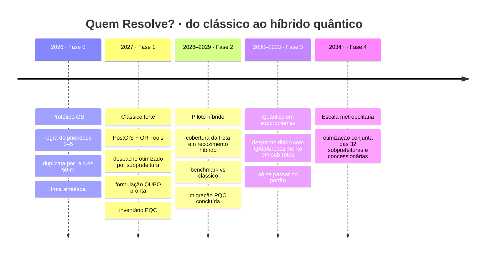

# Roadmap Quântico · Quem Resolve?

> Disciplina 03 · Computação Quântica & IA · Global Solution 2026.2 (CitizenTech)
> v1.1 · 13/11/2026 · Turma 2TIAPY · Integrantes: Matheus Mikio – RM 561864 · Ian Nobres – RM 561861
> Repositório: https://github.com/GS-Citizen-Tech/quem-resolve

**Resumo em uma frase:** à medida que o Quem Resolve? recebe mais reportes (cidadãos + câmeras nos ônibus), o gargalo deixa de ser *identificar* o problema e passa a ser *decidir o que fazer com milhares deles*: quais linhas de ônibus equipar e em que ordem as equipes atendem. Isso é um problema de **otimização combinatória**, e é aí que a computação quântica pode ajudar no futuro, de forma híbrida e só depois de provar que bate os métodos clássicos.

---

## 1. Onde o protótipo está hoje

O fluxo funciona assim: o cidadão manda foto/texto/voz → guardrail → visão (YOLOv8n RDD2022) e PLN classificam → a base "Quem resolve o quê" escolhe o órgão → a ocorrência entra numa fila. Em paralelo, a frota de ônibus (simulada) detecta danos e alimenta a mesma base.

O que decide **o que acontece depois** no código atual:

| Ponto | Como é hoje | Arquivo |
|---|---|---|
| Duplicatas | Varre as ocorrências da mesma categoria e junta se estiver a ≤ 50 m | `api/app/pipelines/ocorrencias.py` (`duplicata_de`) |
| Prioridade | Regra fixa de 1 a 5: base 2 + risco da categoria + 1 se o grupo tiver ≥ 3 reportes ou vier de cidadão e frota | `ocorrencias.py` (`_prioridade`) |
| Fila | Lista por órgão ordenada pela prioridade | console `/gestao/filas` |
| "Possivelmente resolvida" | Ônibus passou a ≤ 25 m e não viu o problema de novo | `api/app/pipelines/frota.py` |
| Quais ônibus têm câmera | Não existe decisão: no protótipo são vídeos gravados pela dupla | `frota/processar_video.py` |
| Quem vai a qual endereço, em que ordem | Não existe: o protótipo para na fila | — |

Com 120 ocorrências simuladas tudo isso é instantâneo. O problema aparece quando se olha para a escala real de São Paulo.

## 2. O gargalo

### 2.1 A escala real

| Dado | Ordem de grandeza | Fonte / observação |
|---|---|---|
| Solicitações no SP156 | ≈ 1,1 milhão/ano (≈ 3 mil/dia) | Boletim SP156 2019 (PRD, seção 1) |
| Subprefeituras | 32 | cada uma com suas equipes de zeladoria |
| Frota de ônibus | ≈ 13 mil veículos, ≈ 1,3 mil linhas | SPTrans, valores aproximados |
| Detecções automáticas | Uma câmera por ônibus pode gerar dezenas de detecções por dia | a Porta 2 **multiplica** o volume, sem depender de alguém reportar |

O próprio sucesso do produto aumenta a carga: mais gente reporta (porque agora sabe a quem recorrer) e os ônibus passam a encontrar problemas que antes ninguém registrava.

### 2.2 Por que este é o gargalo, e não outro

Classificar uma foto custa o mesmo para a 1ª ou para a milionésima ocorrência: escala linear, resolvida com mais máquinas (é o que a simulação do iSPD, disciplina 02, mostra com 2 vs 4 workers). Já **decidir** sobre o conjunto de ocorrências cresce de forma **combinatória**. Há duas decisões assim no Quem Resolve?:

**Decisão A · Cobertura da frota (estratégica, mensal).** Equipar 13 mil ônibus é caro. Se a cidade tem orçamento para, digamos, 100 câmeras, quais das ≈ 1.300 linhas escolher para ver o máximo de vias, com a maior frequência, priorizando onde há mais buracos, bueiros entupidos e alagamentos? É o **problema de cobertura máxima**, NP-difícil. Só o número de formas de escolher 100 linhas entre 1.300 passa de 10¹⁴⁰.

**Decisão B · Despacho das equipes (operacional, diária).** Cada subprefeitura tem dezenas a centenas de ocorrências abertas por dia, com prioridades diferentes, tempos de serviço diferentes, equipes com capacidades diferentes (tapa-buraco ≠ desobstrução de bueiro) e trânsito. Decidir **qual equipe atende o quê e em que ordem** é um **problema de roteamento de veículos com janelas de tempo e prioridades** (VRPTW), também NP-difícil. Uma única equipe com 15 paradas já tem 15! ≈ 1,3 trilhão de ordens possíveis; com várias equipes e restrições, o espaço explode.

### 2.3 O que acontece com a IA clássica quando escala

| Critério | Sintoma no Quem Resolve? |
|---|---|
| **Lenta** | Métodos exatos (programação inteira) resolvem instâncias pequenas, mas o tempo cresce exponencialmente; o despacho precisa ser **refeito ao longo do dia**, porque chega reporte novo e o ônibus marca "possivelmente resolvida". |
| **Cara** | Para caber no tempo, usa-se mais servidor ou se reduz o problema (cada subprefeitura otimiza sozinha, cada equipe só vê sua fila). |
| **Imprecisa** | Heurísticas (OR-Tools, busca local, algoritmos genéticos) dão soluções boas, mas **sem garantia** de quão longe estão da ótima; a regra fixa de prioridade 1–5 de hoje ignora a rota, então uma equipe pode cruzar a zona leste por um buraco de prioridade 4 deixando três de prioridade 3 na mesma rua. |
| **Insegura** | Não é o ponto principal deste gargalo; a segurança aparece na trilha de PQC (seção 5). |

**Gargalo escolhido:** *a priorização e o despacho das ocorrências (decisão B), com a cobertura da frota (decisão A) como primeira aplicação-piloto, porque é menor e tolera esperar.*

## 3. A capacidade quântica escolhida

### 3.1 Otimização

A capacidade escolhida é **otimização combinatória quântica**, por meio de:

- **Recozimento quântico (quantum annealing)**, que procura o estado de menor energia de um problema escrito como **QUBO** (otimização binária quadrática sem restrições);
- **QAOA** (Quantum Approximate Optimization Algorithm), a versão para computadores baseados em portas;
- sempre em modo **híbrido**: o computador clássico divide o problema, prepara os dados e confere a resposta; a parte quântica ataca o miolo combinatório.

**Por que encaixa:** as duas decisões viram QUBO de forma natural.

- Decisão A: uma variável binária por linha ("equipa ou não"); a energia premia via coberta ponderada pela densidade de ocorrências e penaliza passar do orçamento. ≈ 1.300 variáveis: já cabe em solucionadores híbridos de recozimento disponíveis em nuvem.
- Decisão B: variáveis "a equipe *k* atende a ocorrência *i* na posição *t*"; penalidades garantem que cada ocorrência é atendida uma vez e cada equipe está em um lugar por vez. Cresce rápido (100 ocorrências × 5 equipes × 20 posições = 10 mil variáveis), por isso precisa de **decomposição**: o clássico agrupa por região ("cluster first") e o quântico resolve sub-rotas ("route second").

### 3.2 Por que não as outras três capacidades

| Capacidade | Onde poderia entrar | Por que não é a principal |
|---|---|---|
| **Busca em grandes bases** (Grover) | Achar duplicatas na base de ocorrências | O ganho de Grover é quadrático e só para busca **sem estrutura**. Nossa busca é geográfica, com estrutura: um índice espacial clássico (PostGIS/R-tree) já transforma a varredura linear de `duplicata_de` em consulta logarítmica. Além disso, carregar 1 milhão de registros num estado quântico (QRAM) não existe na prática. Problema real, solução clássica. |
| **Simulação** | Simular materiais (asfalto mais durável, sensores) | Útil para a cidade, mas não é um gargalo **do nosso software**: é pesquisa de materiais, fora do protótipo. |
| **PQC** | Proteger fotos, localizações e tokens do console | É **necessária**, mas é software clássico (não precisa de computador quântico) e não acelera nada. Entra como **trilha transversal obrigatória** do roadmap (seção 5), não como a capacidade que ataca o gargalo. |

### 3.3 Honestidade sobre o estado da arte

- Até esta análise (nov/2026) **não há demonstração de vantagem quântica prática** em roteamento de veículos de tamanho real. Solucionadores clássicos de ponta ainda empatam ou ganham.
- Os computadores atuais ainda são ruidosos (NISQ); a correção de erros avançou (ex.: Google Willow em 2024 operando abaixo do limiar) e os roteiros dos fabricantes falam em ≈ 200 qubits lógicos por volta de 2029 (IBM Starling) e milhares no meio da década de 2030. São metas, não garantias.
- Por isso o roadmap **não aposta** no quântico: ele prepara o problema (formulação QUBO), mede contra o clássico e só troca quando houver ganho comprovado. Se nunca houver, a cidade fica com um despacho clássico otimizado, que já é um ganho enorme sobre a fila de hoje.

## 4. Roadmap

### Fase 0 · Hoje (2026): o protótipo da GS

| | |
|---|---|
| **IA clássica entrega** | Classificação por foto/texto/voz, roteamento ao órgão certo, guardrail de emergência, duplicatas por raio de 50 m, prioridade 1–5 por regra, frota simulada, console com mapa e filas. |
| **Quântico** | Nada. Não faz sentido nesta escala. |
| **Benefício ao público** | O cidadão descobre quem resolve em menos de 1 minuto; a servidora (Marina) recebe ocorrência qualificada, com foto e sem duplicata. |
| **Limite** | A fila é ordenada, mas ninguém decide a rota; com milhares de ocorrências a regra fixa vira gargalo. |

### Fase 1 · 2027: clássico forte e "pronto para quântico"

| | |
|---|---|
| **IA clássica entrega** | Índice espacial (PostGIS) para duplicatas; prioridade **aprendida** (risco, recorrência, tempo aberto, vulnerabilidade da região) no lugar da regra fixa; despacho diário com OR-Tools/programação inteira por subprefeitura; cobertura da frota com programação inteira. |
| **Preparação quântica** | Escrever as decisões A e B como QUBO e guardar instâncias de teste **sintéticas** (benchmark público). Isso custa pouco e já melhora o modelo clássico. |
| **Benefício ao público** | Menos tempo entre reporte e reparo; menos deslocamento das equipes; mesmas ruas atendidas em lote. |
| **Indicadores** | Tempo médio reporte → reparo; km rodados por ocorrência resolvida; % de prioridade 4–5 atendida em 48 h. |

### Fase 2 · 2028–2029: piloto híbrido na decisão A

| | |
|---|---|
| **O que roda** | A escolha mensal das linhas que recebem câmera é enviada a um solucionador híbrido de recozimento em nuvem, lado a lado com o clássico. A decisão A é a ideal para piloto: ≈ 1.300 variáveis, roda uma vez por mês (tolera fila no serviço quântico) e **não usa nenhum dado pessoal** (só linhas, trechos de via e contagens agregadas por trecho). |
| **Portão para a Fase 3** | Só avança se, em pelo menos 6 meses de comparação, o híbrido tiver **cobertura ≥ 2% maior** com o mesmo orçamento **ou** mesma cobertura em **tempo/custo menor**, com resultado reproduzível. Se não passar, fica no clássico e reavalia a cada 12 meses. |
| **Benefício ao público** | Mais ruas vistas pela frota com o mesmo dinheiro, principalmente onde ninguém reporta (bairros com menos acesso digital). |

### Fase 3 · 2030–2033: quântico nos subproblemas do despacho

| | |
|---|---|
| **O que roda** | Com os primeiros computadores com correção de erros, o despacho diário vira híbrido: o clássico divide por região e equipe, o quântico (QAOA ou recozimento) resolve as sub-rotas mais difíceis e devolve candidatos; o clássico confere restrições e escolhe. Reotimização ao longo do dia quando entra um reporte de prioridade 5 ou o ônibus marca "possivelmente resolvida". |
| **Regra fixa** | **Guardrail e emergências nunca passam pelo otimizador.** 190/192/193/199 continuam sendo desvio imediato, local e sem fila. |
| **Benefício ao público** | Bueiro entupido desobstruído antes da chuva, buraco grande tapado no mesmo dia, menos idas perdidas a problemas já resolvidos. |

### Fase 4 · 2034+: escala metropolitana

| | |
|---|---|
| **O que roda** | Otimização conjunta entre as 32 subprefeituras e as concessionárias (Enel, Sabesp, Comgás, coleta), compartilhando equipes e janelas de obra (ex.: Sabesp e tapa-buraco na mesma rua, no mesmo dia, em vez de abrir o asfalto duas vezes). |
| **Benefício ao público** | Menos obra repetida, menos trânsito, menos dinheiro público desperdiçado. |

## 5. Trilha transversal: criptografia pós-quântica (PQC)

Mesmo que o quântico nunca vença no despacho, ele **vai** ameaçar a criptografia de hoje (RSA e curvas elípticas, quebráveis pelo algoritmo de Shor num computador grande o bastante). O risco imediato é o **"coletar agora, decifrar depois"**: alguém guarda hoje o tráfego cifrado com localizações de reportes e fotos, e decifra em 10–15 anos.

| Fase | Ação |
|---|---|
| 0 (hoje) | Senhas com bcrypt (hash, não é quebrado por Shor), token assinado, fotos borradas antes de salvar, retenção de 90 dias: isso **reduz o que há para vazar**, que é a melhor defesa. |
| 1 (2027) | Inventário criptográfico: onde há TLS, assinatura de token, Storage cifrado, backups. |
| 2 (2028–2029) | Migrar troca de chaves para **ML-KEM** (FIPS 203) em modo híbrido com o atual, e assinaturas para **ML-DSA** (FIPS 204), padrões publicados pelo NIST em 2024. |
| 3+ | Toda comunicação com serviços quânticos de terceiros já protegida por PQC. |

## 6. Ética, LGPD e ODS ao longo do roadmap

### 6.1 Ética

| Risco | Em que fase aparece | Mitigação |
|---|---|---|
| **Otimizador favorece onde é "barato" atender** (centro denso, ruas próximas) e deixa a periferia por último | 1 em diante | Restrição de **equidade** no modelo: tempo máximo de atendimento por subprefeitura e peso extra para regiões de maior vulnerabilidade (IDH, áreas de risco de alagamento). Painel mostra tempo médio **por região**, não só a média geral. |
| **Prioridade aprendida herda viés** (bairros que reportam mais ganham mais atenção) | 1 | A frota equilibra: ônibus detectam onde ninguém reporta. A cobertura (decisão A) deve ter cota mínima por zona. |
| **Caixa-preta** ("o computador quântico decidiu") | 2–3 | O solucionador só **propõe** rotas; o gestor aprova (human-in-the-loop, como já é no protótipo). Toda rota vem com o motivo em linguagem simples ("3 ocorrências na mesma rua, uma de prioridade 5"). |
| **Gasto público em tecnologia sem retorno** | 2 | Portões com metas numéricas; se não bater, o dinheiro fica no clássico. |
| **Emergência atrasada por otimização** | todas | Guardrail fora do otimizador, sempre. |

### 6.2 LGPD

| Princípio / artigo | Como o roadmap atende |
|---|---|
| **Minimização** (art. 6º, III) | O otimizador só precisa de categoria, prioridade, coordenada (arredondada ao trecho de via) e tempo estimado. **Nunca** recebe foto, descrição, protocolo ou qualquer dado do cidadão. A decisão A usa só contagens agregadas. |
| **Transferência internacional** (art. 33) | Os computadores quânticos de nuvem ficam fora do Brasil. Por isso só sai do país dado **anonimizado/agregado**, que deixa de ser dado pessoal (art. 12); contrato com cláusulas padrão para o resto. |
| **Decisões automatizadas** (art. 20) | A decisão de rota afeta o cidadão indiretamente; o gestor revisa e o motivo fica no histórico (`ocorrencias_historico`, já existe no banco). |
| **Segurança** (art. 46) | Trilha PQC (seção 5) + borramento de rostos/placas e descarte do vídeo bruto, já implementados. |
| **Retenção** | 90 dias após resolvida (já no `PLANO-BANCO.md`); as instâncias de benchmark são sintéticas. |
| **Relatório de impacto (RIPD)** | Obrigatório antes da Fase 2, porque passa a haver um operador novo (provedor quântico). |

### 6.3 ODS

| ODS | Meta | Como o roadmap contribui | Fase |
|---|---|---|---|
| **11 · Cidades sustentáveis** | 11.1, 11.7 | Vias e calçadas reparadas mais rápido, espaço público mais seguro e acessível (Dona Cida e o Rafael). | 0 → 4 |
| **11 / 13 · Clima** | 11.5, 13.1 | Bueiros desobstruídos antes da chuva reduzem alagamentos. | 1 → 3 |
| **9 · Indústria, inovação e infraestrutura** | 9.1, 9.5 | Infraestrutura mantida com dados; capacitação da cidade em tecnologias emergentes. | 1 → 4 |
| **10 · Redução das desigualdades** | 10.2 | Restrição de equidade e frota cobrindo onde não há reporte. | 1 → 4 |
| **16 · Instituições eficazes** | 16.6, 16.7 | Menos "pingue-pongue" entre órgãos, decisões explicadas, gestor no controle. | 0 → 4 |
| **12 · Consumo responsável** | 12.5 | Menos km rodados, menos obra repetida (Fase 4). | 3 → 4 |

## 7. Conclusão

- **Gargalo:** decidir, sobre milhares de ocorrências por dia, quais atender primeiro, com que equipe e em que ordem, e onde pôr as câmeras da frota. Cresce de forma combinatória com o número de cidadãos atendidos; a IA clássica fica lenta (exato) ou imprecisa (heurística).
- **Capacidade:** otimização combinatória quântica (QUBO, recozimento e QAOA), em modo híbrido.
- **Quando faz sentido:** não agora. Primeiro um despacho clássico forte (2027), depois um piloto híbrido na decisão de cobertura, que é pequena, mensal e sem dado pessoal (2028–2029), e só então o despacho diário (≥ 2030), **se** os portões de benchmark forem vencidos. PQC é a parte do quântico que tem data certa e começa já.
- **Para o público:** buraco tapado e bueiro limpo mais cedo, com a periferia protegida por regra, os dados do cidadão fora do otimizador e uma pessoa sempre aprovando a decisão.

### Resumo do roadmap em uma tabela

| Fase | Período | IA clássica entrega | Quântico agrega | Benefício ao público | Ética / LGPD / ODS |
|---|---|---|---|---|---|
| 0 | 2026 | Classificação, roteamento ao órgão, guardrail, fila por regra 1–5 | — | Sabe quem resolve em < 1 min | Sem cadastro, borramento, retenção 90 dias · ODS 11, 16 |
| 1 | 2027 | Prioridade aprendida, despacho otimizado (OR-Tools), índice espacial | Formulação QUBO e benchmark sintético | Reparo mais rápido, menos km rodados | Restrição de equidade, inventário PQC · ODS 11, 10 |
| 2 | 2028–2029 | Despacho clássico em produção | Piloto híbrido na cobertura da frota (sem dado pessoal) | Mais ruas vistas com o mesmo orçamento | RIPD, só dado agregado sai do país, PQC (ML-KEM/ML-DSA) · ODS 9, 10 |
| 3 | 2030–2033 | Decomposição, conferência e aprovação humana | Sub-rotas do despacho diário (QAOA/recozimento), se passar no portão | Bueiro limpo antes da chuva, buraco no mesmo dia | Art. 20 (motivo explicado), guardrail fora do otimizador · ODS 11.5, 13.1 |
| 4 | 2034+ | Integração entre órgãos | Otimização conjunta das 32 subprefeituras e concessionárias | Menos obra repetida e trânsito | Governança compartilhada entre órgãos · ODS 12, 16 |

## Referências

- BRASIL. Lei nº 13.709, de 14 de agosto de 2018. Lei Geral de Proteção de Dados Pessoais (LGPD).
- CÂMARA MUNICIPAL DE SÃO PAULO. Boletim CTTAE: Central SP156, 2019.
- FARHI, E.; GOLDSTONE, J.; GUTMANN, S. A Quantum Approximate Optimization Algorithm. arXiv:1411.4028, 2014.
- LUCAS, A. Ising formulations of many NP problems. *Frontiers in Physics*, v. 2, 2014.
- GOOGLE QUANTUM AI. Quantum error correction below the surface code threshold. *Nature*, 2024.
- IBM. IBM Quantum roadmap (Starling, 2029). 2025.
- NIST. FIPS 203 (ML-KEM), FIPS 204 (ML-DSA) e FIPS 205 (SLH-DSA). 2024.
- ONU. Agenda 2030 e Objetivos de Desenvolvimento Sustentável.
- PERRON, L.; FURNON, V. OR-Tools. Google, 2024.
- QUEM RESOLVE? PRD v0.4, PLANO-BANCO v1.0 e código-fonte (`api/app/pipelines/ocorrencias.py`, `frota.py`). 2026.
